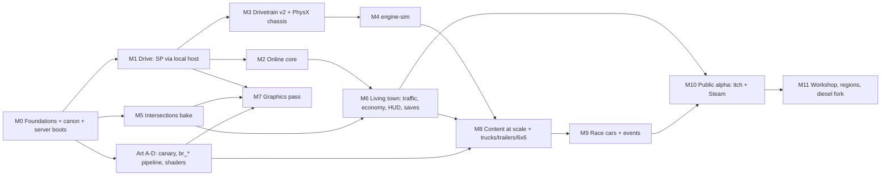

# Proposal: "Online and scale first"

*Backroads in Unity: repository, architecture, engine-sim, graphics, online and roadmap. Architect's proposal, 2026-10-18.*

*Evidence base: the seven research reports in `docs/unity/research/`, cited as (NN §x). For example, (04 §3.2) means report 04, section 3.2. Where this proposal picks between two reports that disagree, it says so and gives the reason.*

---

## 0. In one screen

**Thesis.** Build Backroads as a server-plus-clients game from the first commit.

- **Single-player is the same program with the server running inside it** (a "local host") and no network socket opened.
- **One authority decides everything players share:** money, jobs, AI traffic, the time of day, fallen trees, and the ground you dig up. That code never asks whether anyone else is connected.
- **Each player's own vehicle is simulated on that player's PC** (owner-authoritative). This is what makes engine-sim, deep mud and the winch workable online at all (04 §3.2, 06 §4.6).

**What this means for you, in plain terms**

- **M1, the first drivable build,** is single-player, as it would be in any plan.
- **Two players** (on one PC, or two PCs on your home network) come about three weeks later, at M2, not "someday".
- **A dedicated server program** exists from M0. By M6 it keeps a persistent world that survives restarts.
- **New trucks, race cars and towns** are data files plus a run of automatic "conformance tests". They are not new code.
- **The price:** roughly 15 % more work in the first two months. In return, netcode never has to be retrofitted into the physics, economy and save code. A retrofit is the usual way hobby driving games die on the way to multiplayer.

### 0.1 Key decisions

| # | Decision | Evidence |
|---|---|---|
| 1 | **New private repo `Backroads-Unity`.** The three.js game is a **pinned git submodule** at `552f780` and acts as the canon oracle. Canon is exported once, hashed and committed. Unity never regenerates the world | 03 §0, §3 |
| 2 | **Unity 6.3 LTS** (6000.3.20f1 installed; update to 6000.3.26f1 recommended), URP 17.3 Forward+, then move to 6.7 LTS when it is stable. Not 6000.5 | 04 §1 |
| 3 | **Split authority.** The server owns shared state. Owners own their vehicles, with server validation. Coupled bodies (trailer, tow strap, winch to a vehicle) **move to one owner** while coupled | 04 §3.2, 06 §6.1 |
| 4 | **Netcode for GameObjects 2.13.3 + Unity Transport 2.7.4**, with custom compact messages instead of NetworkTransform. Transports: a `LocalOnlyTransport` for single-player, UTP for LAN, dedicated servers and loopback tests, and Steam SDR (Facepunch) for internet play | 04 §3.4, §3.7 |
| 5 | **Deterministic terrain:** integer fixed-point deformation stamps, a server-ordered stamp log, and per-tile hashes with resend. The canon starting heights stay bit-exact | 06 §5.6, 03 §3.2 |
| 6 | **The simulation core has no netcode in it.** WorldGrid, BRV vehicles, traffic and economy are plain C# and Burst. Only `Backroads.Net` touches NGO, so the netcode library can be swapped (Mirror 96.x is the fallback) | 04 §3.4 |
| 7 | **BRV, our own vehicle physics:** 1/120 s fixed step with 4 substeps and an implicit row solver for tyres and shafts. No WheelCollider | 06 §0, §3 |
| 8 | **engine-sim** runs as an unmodified vendored native plugin, with the ABI from 01 §7. Coupling is Option D: Unity owns the crank. It runs only on clients. Servers and AI use baked torque maps | 01 §3.6, §6.3, 06 §4.4 |
| 9 | **Roads:** our own editor bake (`Backroads.Roads`). Clients and the dedicated server load the same baked meshes, colliders and lane graph | 05 §0, §3 |
| 10 | **Graphics:** URP with GPU Resident Drawer, STP, SSAO, APV sky occlusion (baked once, because canon is frozen), and a follow-cam reflection probe | 04 §2, 07 §2 |
| 11 | **Content scales by data:** content packs, stable `ContentId`s, a batchmode content compiler, and conformance suites that every vehicle, engine and region must pass | this proposal §2.7 |
| 12 | **"Free to play online"** means Steam with player-hosted sessions over SDR, plus a free dedicated-server build. That costs you **$0 per month** at any player count (the Steam fee is $100 once). itch.io is used for early tests | 04 §3.6, §4 |

### 0.2 What this plan deliberately does not do

- No server-authoritative vehicles with prediction and rollback, and no lockstep simulation. engine-sim and PhysX are not deterministic (01 §6.3, 06 §4.6).
- No ECS or Netcode for Entities: that would mean rewriting vehicles, mud and winch (04 §3.4).
- No engine-sim on the server: a full engine costs about 0.25-0.5 core per player (01 §6.3).
- No WheelCollider (06 §3.1), no HDRP (04 §2.1), no commercial road tool (05 §2).
- No Synty files in git, in mods, or in any AI tool (04 §6, 07 §10.4).

---

## 1. Repository and project layout

### 1.1 New repository, with the JS game as a pinned submodule

**Choice:** a new private GitHub repo, `kaiwren986/Backroads-Unity`, cloned at **`D:\BackroadsUnity`**. You create the GitHub repo and do every push yourself. Agents commit locally and never push.

**Why not a folder inside `D:\Backroads`:**
1. The JS repo then stays frozen and small, and `Play.bat` keeps working for side-by-side comparisons.
2. The Unity repo needs Git LFS, a Unity `.gitignore`, native build output and a much larger history.
3. The oracle commit becomes an explicit submodule pointer. Changing canon means deliberately bumping that pointer, which is a visible event you can review.
4. A future public mod SDK can be split out cleanly.

The research and design docs (untracked in `D:\Backroads\docs\unity` today) move to `docs/` in the new repo.

### 1.2 Tree

```
D:\BackroadsUnity\
  .gitattributes / .gitignore / .lfsconfig
  oracle\
    backroads-js\                  git submodule -> kaiwren986/Backroads @ 552f780 (never edited)
    export\                        overlay applied to a TEMP COPY of the submodule at export time
      exportUnity.js               the exporter (03 §3.4)
      props-export-hooks.patch     the 3 one-line hooks (treeList, props.rocks, allOps) (03 §3.4)
      goldenTraces.js              scripted-input traces via G.update(1/120), G.noRender (03 §3.6)
      cameras.json                 12 reference camera poses, shared by JS and Unity
      serve-overlay.mjs            static server on 127.0.0.1:8130: temp copy + overlay
  canon\
    CanonData\v1\                  exported layers + JSON + manifest (Git LFS for *.f32, *.u8)  (03 §3.3)
    golden\*.json                  JS golden traces (6 scenarios)
    reference\shots\*.png          JS screenshots, 12 cameras x {10:00, 21:00}
    overrides\v1.1\                roads-overrides.json, r3-realignment.json, RoadPlates.delta (05 §3, §5.10)
    CHANGES.md                     the ledger of every approved deviation from v1 (who, when, why, hashes)
  Game\                            THE UNITY PROJECT (open this folder in Unity Hub)
    Assets\Backroads\...           our code, one folder per assembly (1.4)
    Assets\Content\core\...        the base content pack (vehicles, engines, tyres, regions) (2.7)
    Assets\StreamingAssets\EngineSim\es\...   engine-sim .mr library + IR .wav (01 §7.4)
    Assets\Plugins\x86_64\EngineSimPlugin.dll   copied by ci\native.ps1 (not committed; built)
    Assets\ThirdParty\Clipper2\, LibTessDotNet\, Facepunch\   source or DLLs with licence files
    Assets\ThirdParty\Synty\       GIT-IGNORED; restored from your own downloads (07 §10.5)
    Packages\manifest.json, packages-lock.json
    ProjectSettings\
  native\EngineSimPlugin\          CMake project (1.5)
  art\
    vehicles\<id>\<id>.blend, brief.md      (07 §4.1, §8.2)  (Git LFS)
    trims\TS_Vehicle_A.blend
  tools\
    blender\pipeline\br_*.py       (07 §5.1)
    blender\legacy\                copies of vehicles.py/trees.py/buildings.py (the oracle keeps the originals)
    winflexbison\                  only if you approve the download (3.2); not committed
  ci\                              PowerShell entry points (1.8)
  builds\                          local milestone builds, git-ignored (M0\, M1\ ... each with .bat launchers)
  artifacts\                       test results, logs, screenshots, git-ignored
  docs\research\, docs\design\
  synty-manifest.json              which Synty packs, versions and storefront; no files (07 §10.5)
```

### 1.3 Unity project and packages

**Project settings:**
- Project: `D:\BackroadsUnity\Game`, URP template, Linear colour space.
- Scripting backend: Mono for the editor, IL2CPP for release clients. The dedicated server can stay Mono.
- *Enter Play Mode: Do not reload Domain or Scene* is on from day one. Static state is reset with `[RuntimeInitializeOnLoadMethod(SubsystemRegistration)]` (04 §1.2).
- Physics: `defaultSolverType = TemporalGaussSeidel`, `Time.fixedDeltaTime = 1/120`, `maximumDeltaTime = 0.05` (06 §3.4).

**Rules from 04 §1.2:**
- Never store `GetInstanceID()` as an int.
- Turn on Read/Write for every mesh a `MeshCollider` uses.
- Never embed Burst.
- No `com.unity.serialization`.
- No dynamic batching.

**Packages** (versions as checked in 04 §5; pin them in `manifest.json`):

| Package | Version | Used for | From |
|---|---|---|---|
| `com.unity.render-pipelines.universal`, `.shadergraph`, `.visualeffectgraph` | 17.3.0 (bundled) | rendering, shaders, dust and mud VFX | M0 |
| `com.unity.inputsystem` | 1.20.1 | Driving, OnFoot and UI action maps (03 §4.26) | M1 |
| `com.unity.burst` / `.collections` / `.mathematics` | 1.8.31 / 2.7.1 / 1.3.3 | WorldGrid, BRV, stamps, meshing | M0 |
| `com.unity.netcode.gameobjects` | **2.13.3** (2.13.0 is bundled; pin .3) | sessions, RPCs, custom messages | M0 |
| `com.unity.transport` | 2.7.4 | UDP, loopback, debug network simulator | M0 |
| `com.unity.dedicated-server` | 2.0.2 | server build profile, Multiplayer Roles | M0 |
| `com.unity.multiplayer.playmode` / `.tools` | 2.0.2 / 2.2.12 | virtual players in the editor, network stats | M2 |
| `com.unity.cloud.gltfast` | 6.20.0 (avoid 7.0.0-exp) | import today's GLBs in M0; runtime mod path later | M0 |
| `com.unity.test-framework` (bundled), `com.unity.test-framework.performance` (pin what Package Manager offers) | — | EditMode, PlayMode and performance tests | M0 |
| `com.unity.addressables` | 2.11.2 | content packs as groups; server-without-visuals; mod catalogs later | M8 |
| `com.unity.memoryprofiler` | 1.1.12 | server memory budget | M6 |
| `com.unity.services.multiplayer` | 2.4.1 | **only if** you choose Unity Relay for itch builds (needs a UGS project you create) | M10 |
| `com.unity.platformtoolkit` + `.steam` | 1.2.0 | achievements and Steam Cloud saves (optional) | M10 |
| Facepunch.Steamworks (MIT) + NGO Facepunch transport | 2.5.2 + 2.0.0 | Steam SDR P2P, lobbies, auth tickets | M10 |
| Clipper2 C# (BSL-1.0, pin a release tag), LibTessDotNet | tag + 1.1.15 | road bake (05 §0) | M5 |
| `com.cqf.urpvolumetricfog` (MIT, OpenUPM) | latest; re-test on 6.7 | optional volumetric fog | M7 |

**Not used:** Cinemachine (the camera is a straight port, 03 §4.19), Entities, Netcode for Entities, `com.unity.vehicles`, HDRP, Splines for roads (05 §2: editor gizmos at most).

### 1.4 Assembly definitions

**The rule that makes "single-player is a local host" and "server build = same game minus presentation" true:**
- **No shared assembly references a client-only assembly.**
- Client assemblies carry `defineConstraints: ["!UNITY_SERVER"]`, so dedicated-server builds compile them out.
- Client assemblies plug in at start-up by registering factories in `Backroads.Core.PresentationRegistry`, using `[RuntimeInitializeOnLoadMethod(AfterAssembliesLoaded)]`.
- Only `Backroads.Net` references `Unity.Netcode.Runtime`.

| Assembly (folder under `Assets/Backroads/`) | References | Constraint | Contents (key types) |
|---|---|---|---|
| `Backroads.Core` (`Core/`) | Mathematics, Collections, Burst | — | `BrCoords` (03 §2), `SimTick`, `SimClock`, `ContentId`, `Fixed` (Q-format helpers), `CommandLine`, `PresentationRegistry`, `Log` |
| `Backroads.World` (`World/`) | Core | — | `WorldGrid`, `WorldTiles`, `RutStamp`, `StampKernels` (Burst, integer), `SurfaceTable`, `CanonRuntime` (reads `.bytes`), `ColliderGrid`, `VegetationData`, `PlacementData` |
| `Backroads.Roads` (`Roads/`) | Core, World | — | `RoadNetworkAsset`, `LaneGraph`, `Lane`, `Connector`, `Conflict`, `ControlSet`, `SignalController`, `RoadPlates` (applied to WorldGrid at load) (05 §4) |
| `Backroads.Vehicles` (`Vehicles/`) | Core, World | — | `VehicleDefinition`, `DrivelineDef`, `TyrePreset`, `VehicleSetup`, `BrvState`, `BrvStepJob`, `Row`, `ShaftGraph`, `MudModel`, `Winch`, `HitchDef`, `IVehicleEngine`, `TorqueMapEngine`, `VehicleInput`, `VehicleSnapshot` |
| `Backroads.EngineSim` (`EngineSim/`) | Core, Vehicles | `!UNITY_SERVER` | `EngineSimNative` (P/Invoke, plus the editor hot-reload loader), `EngineSimEngine : IVehicleEngine`, `ReplicatedEngine`, `EngineSimAudio`, `EngineAudioScheduler`, `LoopBankPlayer` |
| `Backroads.Traffic` (`Traffic/`) | Core, World, Roads, Vehicles | — | `TrafficSystem` (server), `TrafficDriver`, `JunctionArbiter`, `GhostAgent`, `TrafficSnapshot` |
| `Backroads.Economy` (`Economy/`) | Core | — | `CargoType`, `FreightBoard`, `Offer`, `JobLedger`, `Wallet`, `EconomyRules` (03 §4.22) |
| `Backroads.Persistence` (`Persistence/`) | Core, World, Economy, Vehicles | — | `WorldSave`, `PlayerProfile`, `SaveService`, `SaveMigrations` |
| `Backroads.Net` (`Net/`) | all of the above (shared only), Unity.Netcode.Runtime, Unity.Networking.Transport | — | `SessionLauncher`, `LocalOnlyTransport`, `ContentHandshake`, `VehicleReplicator`, `InterestManager`, `StateValidator`, `DeformReplicator`, `TrafficReplicator`, `EconomyService`, `ClockService`, `OwnershipBroker`, `WorldStateService` |
| `Backroads.Net.Steam` (`Net/Steam/`) | Net, Facepunch | `BACKROADS_STEAM` | `SteamBootstrap`, `SteamLobbyService`, `SteamAuth` |
| `Backroads.Game` (`Game/`) | shared assemblies + Net | — | `GameBootstrap` (composition root), scene setup, `GameRules` |
| `Backroads.Server` (`Server/`) | Game | `UNITY_SERVER` | `ServerMain` (CLI, `server.cfg`, admin console, autosave, ban list) |
| `Backroads.Client` (`Client/`) | shared + EngineSim | `!UNITY_SERVER` | `ChaseCameraRig`, `HoodCamera`, `FootCamera`, `InputBindings`, `VehicleVisual`, `WheelVisuals`, `CharacterVisual`, `EffectsEmitter`, `NonEngineAudio` |
| `Backroads.Client.Rendering` | Core, World, Roads | `!UNITY_SERVER` | `TerrainChunkRenderer`, `TerrainMeshJob`, `GrassRenderer`, `TreeSpawner`, `BuildingRenderer`, `RoadChunkLoader`, `SkyController`, `WaterSurface`, `NightLights`, `QualityTiers` |
| `Backroads.Client.UI` | Core, Economy, Net | `!UNITY_SERVER` | `HudController`, `MinimapView`, `BigMapView`, `FreightBoardPanel`, `SessionMenu`, `SettingsPanel` (UI Toolkit) |
| `Backroads.Testing` | all | dev builds only (`BACKROADS_TESTING`) | `Autopilot` (scripted input timelines), `GoldenTraceRecorder`, `ShotRig`, `HashLog`, `BotClient` |
| Editor: `Backroads.Canon.Editor`, `Backroads.Roads.Editor`, `Backroads.Content.Editor`, `Backroads.Build.Editor` | | Editor | `CanonImporter`, `RoadBakePipeline`, `ContentBuild`, `VehicleJsonImporter`, `BackroadsModelPostprocessor`, `VehiclePrefabBuilder`, `EngineBake`, `CI` (build and test entry points) |
| Tests: `Backroads.Tests.EditMode`, `.PlayMode`, `.Performance` | | test assemblies | listed per milestone in §6 |

**Architecture tests** (EditMode, category `Architecture`) enforce these rules by reflection over the compiled assemblies, so agents can't erode them:
- No shared assembly references NGO except `Backroads.Net`.
- No shared assembly references a client assembly.
- No `MaterialPropertyBlock` usage in `Client.Rendering` (GPU Resident Drawer compatibility, 04 §2.2).
- No `IsSinglePlayer`-style branch outside `Net` and `UI`.

### 1.5 Native plugin source

`native\EngineSimPlugin\` is a CMake 4.x project built with VS 2022 (generator "Visual Studio 17 2022", `-A x64`):

```
native\EngineSimPlugin\
  CMakeLists.txt                 our own; never add_subdirectory(upstream)  (01 §1.4, 02 §2)
  vendor\engine-sim\             git subtree of upstream 85f7c3b + scs e009f4f + csv-io + piranha 432f0b1, UNMODIFIED
  vendor\piranha-generated\      scanner.auto.cpp, parser.auto.cpp, parser.auto.h (+ location/stack headers bison emits),
                                 generated once by win_flex_bison 2.5.25 and committed  (01 §5.4)
  shim\delta-studio\...          two empty headers so synthesizer.cpp compiles untouched  (01 §1.3)
  src\
    plugin_api.cpp / EngineSimPlugin.h    the C ABI (01 §7.2, plus §3.3 below)
    unity_sim.cpp                class UnitySim : PistonEngineSimulator (writeToSynthesizer override, attach())  (01 §7.3, A.3)
    unity_transmission.cpp       class UnityTransmission : Transmission (clutchTorque())  (01 §3.2)
    generators.cpp               SlavedCrankPD, WheelLoad force generators  (01 A.4)
    render_sync.cpp              synchronous synthesizer drain into SPSC ring  (01 §4.3)
    fir_avx2.cpp                 AVX2 FIR + SSE2 fallback with CPUID dispatch  (01 A.5)
    spsc_ring.h, wav_io.cpp, resample.cpp, worker.cpp, piranha_path_std.cpp (01 A.6)
  patches\                       EMPTY in v1. Fork work (turbo, diesel) lives here as a patch series applied to a build copy (3.9)
  tools\esp_tool.cpp             CLI: load, sweep, calibrate, render-loops, bench, export-csv
  tests\esp_tests.cpp            ctest: the 01 §3.5 co-simulation table, J_eff calibration, V12 OOB regression
  THIRD_PARTY_NOTICES.md         MIT texts: engine-sim, scs, csv-io, piranha (01 §5.4)
```

**CMake targets:**
- `scs` (static, 29 files).
- `enginesim_core` (static, the 41 upstream `src/*.cpp`, with the shim first on the include path).
- `piranha` (static: everything except `path.cpp`, plus `piranha_path_std.cpp` and the generated parser).
- `es_script` (the 4 scripting sources).
- **`EngineSimPlugin`** (SHARED).
- `esp_tool`, `esp_tests`.

**Flags** (01 §7.1):
- `/MT`, `NDEBUG` always, `/fp:fast`.
- `/arch:AVX2` only on `fir_avx2.cpp`.
- No Boost, no network, no googletest download.

`ci\native.ps1` copies the DLL to `Game\Assets\Plugins\x86_64\`.

**Editor DLL lock:** Unity keeps a native DLL loaded until the editor restarts (01 §7.4). In the editor, `EngineSimNative` therefore loads a **timestamped copy** with `LoadLibrary`/`GetProcAddress` and calls it through function pointers. Player builds use plain `[DllImport]`.

### 1.6 Blender pipeline

This follows 07 §5. The legacy generators are copied (not moved) into `tools\blender\legacy\`. The oracle keeps its originals, which produced canon.

| Script | Role |
|---|---|
| `br_common.py` | names, `SLOT_MAP`, per-class budgets, game↔Blender↔Unity transforms |
| `br_generate.py` | calls the `build_*()` builders, saves a `.blend`, and drops `SOCKET_*` empties for wheels, lights, exhausts, hitch and winch |
| `br_uv.py`, `br_bake.py`, `br_lod.py` | UV0 and UV1 (livery), Cycles/OptiX bakes on the RTX 5080, LOD0-3 by subdivision level |
| `br_validate.py` | fails on budget, naming, scale or UV errors; writes `build_report.json` |
| `br_export.py` | FBX (07 §3.2 flags) **+ GLB** (for mods) + `<id>.vehicle.json` sidecar + PNGs + 6-view EEVEE review sheet |
| `tools\build-vehicle.bat <id>` | `"%LOCALAPPDATA%\Programs\Blender Foundation\Blender 4.5\blender.exe" -b art\vehicles\<id>\<id>.blend --factory-startup --python tools\blender\pipeline\br_build.py -- --id <id> --unity Game` |

**On the Unity side:**
- `BackroadsModelPostprocessor` remaps `M_*` materials by name and turns `UCX_*` meshes into convex colliders (07 §3.3).
- `VehicleJsonImporter` (a ScriptedImporter for `*.vehicle.json`) produces the `VehicleDefinition` geometry block.
- `VehiclePrefabBuilder` writes the generated base prefab. Your hand tweaks live in a Prefab Variant.

### 1.7 The data export tool and the canon identity contract

**How the three.js build stays the oracle:**

1. **It is never edited.** The export runs from a temp copy of the submodule with `props-export-hooks.patch` applied. The patch only exposes data and does not change RNG consumption (03 §3.4).
   - The export refuses to run unless the patched copy reproduces **every** hash in 03 §3.2 (H `a8908d7f…`, BASE `2eda4082…`, SURFACE `8788d405…`, ROADD `8d31f109…`, MUD `2192f4c8…`, WEAR `85473f6f…`, TINT `08452b46…`).
   - It also checks the counts: 5,265 trees, 4,013 colliders, 78 lamps, 59 lots, 24 roads, 53 lanes, 108 connectors, 5 loops.
2. **It runs in a real browser.** The traffic network differs headless (52 lanes) from the browser (53 lanes) (03 §3.1).
   - `node oracle\export\serve-overlay.mjs` serves the temp copy on `127.0.0.1:8130`.
   - You (or an agent in the built-in browser, with your OK for the folder write) open `http://127.0.0.1:8130/?export=unity`.
   - The File System Access API writes `canon\CanonData\v1\`.
   - A Playwright automation would need an npm install, so it waits for your approval.
3. **What it writes:**
   - `CanonData/v1` (03 §3.3): heights, base, surface, wear, roadd, mud and tint layers; world, placements, vegetation and traffic JSON; textures; `static_props.glb`; `manifest.json` with SHA-256 for every file.
   - `terrain/probes.json`: 1,000 seeded probe points.
   - `canon/golden/*.json`: the 6 golden traces (03 §3.6).
   - `canon/reference/shots/`: 12 cameras × 2 times of day.
4. **Unity only imports.** `Backroads.Canon.Editor.CanonImporter` verifies the manifest hashes, copies the binaries to `Assets/Backroads/World/Canon/*.bytes`, builds the ScriptableObjects, and self-tests heights against the probes (03 §3.5).
5. **Any deviation is a versioned overlay with a ledger entry.** Examples: the roundabout's R3 realignment, road plates, junction plates.
   - Overlays live in `canon\overrides\v1.1\`. Each change is listed in `canon\CHANGES.md` with your approval, the reason, and the before and after hashes.
   - v1 hashes are checked **before** an overlay is applied, and v1.1 hashes after.
6. **The canon identity contract**, as tests (category `Canon`) that every CI run executes:
   - (a) boot layer hashes equal the manifest;
   - (b) placement counts equal the table above;
   - (c) every building, tree, rock and lamp transform equals `BrCoords` applied to the exported values (tolerance 1e-5 m, 1e-4°);
   - (d) the heightAt, normalAt and surfaceAt probes match (1e-5 m; surface exact);
   - (e) the 12-camera side-by-side sheet is regenerated for review.

### 1.8 CI and batchmode scripts (local; run by agents on your machine)

There is no cloud CI: Unity licence activation in the cloud needs a sign-in. Every script is PowerShell under `ci\` and writes to `artifacts\<date>\`.

| Script | Does | Core command |
|---|---|---|
| `ci\env.ps1` | paths | `$Unity = "C:\Program Files\Unity\Hub\Editor\6000.3.20f1\Editor\Unity.exe"`; Blender 4.5; CMake; `$Proj = "D:\BackroadsUnity\Game"` |
| `ci\native.ps1` | build + test the plugin | `cmake -S native\EngineSimPlugin -B native\build -G "Visual Studio 17 2022" -A x64; cmake --build native\build --config Release --parallel 16; ctest --test-dir native\build -C Release` |
| `ci\canon-verify.ps1` | hashes, counts, probes | `& $Unity -batchmode -nographics -projectPath $Proj -runTests -testPlatform EditMode -testCategory Canon -testResults artifacts\canon.xml -logFile artifacts\canon.log` |
| `ci\test.ps1 -Platform EditMode\|PlayMode -Category X` | any test set | same, with `-testCategory X` (do not pass `-quit` with `-runTests`) |
| `ci\build.ps1 -Target Client\|Server -Os Win64\|Linux64` | players | `& $Unity -batchmode -quit -projectPath $Proj -executeMethod Backroads.Build.Editor.CI.BuildClient` (or `BuildServer`, which sets `BuildPlayerOptions.subtarget = (int)StandaloneBuildSubtarget.Server`) |
| `ci\shots.ps1 -Set canon\|junctions\|lighting` | screenshots and comparison sheets | `builds\dev\Backroads.exe -shots canon -shotsOut artifacts\shots -quitAfter 120`, then an editor method composes JS\|Unity sheets |
| `ci\soak.ps1 -Clients 4 -Minutes 10 -DelayMs 150 -JitterMs 20 -DropPct 2` | multiplayer soak | starts `BackroadsServer.exe -batchmode -nographics -port 7777 -hashlog …` and N × `Backroads.exe -batchmode -nographics -connect 127.0.0.1:7777 -bot bots\bog_loop.json -noengine -netsim 150,20,2 -hashlog …`, then diffs the hash logs |
| `ci\content.ps1` | the content pipeline | Blender builds for changed vehicles → `-executeMethod Backroads.Content.Editor.ContentBuild.BuildAll` → conformance suites |
| `ci\all.ps1` | nightly | native → canon → EditMode → PlayMode → builds → soak → shots |

**Player command line** (parsed by `Backroads.Core.CommandLine`):

| Flag | Meaning |
|---|---|
| `-mode sp\|host\|join\|server` | session type |
| `-connect ip:port`, `-port N` | where to connect or listen |
| `-save <slot>`, `-region millbrook` | save slot and world region |
| `-maxPlayers N` | session size |
| `-bot <script.json>` | drive with a scripted autopilot |
| `-noengine` | `TorqueMapEngine` instead of engine-sim |
| `-netsim delay,jitter,drop` | `UnityTransport.SetDebugSimulatorParameters`, dev builds only |
| `-hashlog <file>` | write tile-hash summaries |
| `-shots <set> -shotsOut <dir>` | capture screenshot sets |
| `-quitAfter <s>` | exit after N seconds |

### 1.9 Repository hygiene

- **Git LFS:** `*.f32 *.u8 *.bytes *.blend *.fbx *.glb *.png *.wav *.ogg *.exr`.
- **Git-ignored:** `Game/Library`, `Game/Temp`, `Game/Logs`, `Game/UserSettings`, `builds/`, `artifacts/`, `native/build/`, `Game/Assets/ThirdParty/Synty/`, `Game/Assets/Plugins/x86_64/EngineSimPlugin.dll`.
- **Reference photos** live in `D:\Backroads-ref\vehicle-refs\` and are never committed (07 §8.3).
- **LFS quota:** GitHub Free includes 10 GiB of LFS storage (07 §10.5). The canon is about 30 MB gzipped (03 §3.3), so this is fine. Watch it once `.blend` files accumulate.

---

## 2. Architecture

### 2.1 Layers

```
 ┌──────────────────────────── Client presentation (!UNITY_SERVER) ───────────────────────────────┐
 │ Rendering: terrain chunks, grass, trees, buildings, roads, sky, water, VFX   UI Toolkit HUD/maps  │
 │ Camera rigs, input, character visuals   EngineSim (native plugin, audio)   non-engine audio      │
 └───────────────▲──────────────────────── reads state, sends inputs/requests ───────────────▲──────┘
                 │                                                                            │
 ┌───────────────┴──────────────── Backroads.Net (NGO; the ONLY netcode code) ────────────────┴─────┐
 │ SessionLauncher (SP / Host / Join / Server)  ContentHandshake  InterestManager  StateValidator     │
 │ VehicleReplicator  DeformReplicator  TrafficReplicator  EconomyService  ClockService  OwnershipBroker│
 └───────────────▲──────────────────────── authorities run here when IsServer ──────────────▲───────┘
                 │                                                                           │
 ┌───────────────┴──────────────── Simulation core (plain C# + Burst, no NGO, no MonoBehaviour) ──────┐
 │ WorldGrid + StampKernels (int)   Roads runtime (LaneGraph, controls)   BRV vehicles (owner or AI)   │
 │ TrafficSystem (server)   Economy rules (server)   Persistence   SimClock                            │
 └────────────────────────────────────────────────────────────────────────────────────────────────────┘
                 ▲ loaded once, identical everywhere (hashed): CanonData v1(+v1.1), RoadNetworkAsset, ContentDatabase
```

**The three topologies use the same binaries and the same scene:**

| Topology | Server authorities | Simulates player vehicles | Renders | engine-sim |
|---|---|---|---|---|
| **Single-player** = local host on `LocalOnlyTransport` (no socket) | in-process | its own | yes | local engine |
| **Listen host** (friends) on UTP (LAN or direct IP) or Steam SDR | in-process on the host | each client its own | yes | each its own, plus remote tiers |
| **Dedicated server** (`BackroadsServer.exe`, Windows first, Linux possible) | yes | none (kinematic proxies only) | no | **never** (torque maps for AI) |

`LocalOnlyTransport` is a `NetworkTransport` whose `StartServer()` succeeds, and which never accepts connections and never sends. NGO handles the host's own client internally.
- **Spike S-NET-1 (M0, half a day):** confirm this on NGO 2.13.3. The fallback is UTP bound to `127.0.0.1` on an ephemeral port.
- **"Open to friends" from a single-player game:** flush the save, `NetworkManager.Shutdown()`, switch `NetworkConfig.NetworkTransport` to UTP or Steam, `StartHost()`, reload the save. That should take under 5 s.
- **Pausing** (`Time.timeScale = 0`) is allowed only when the session has one connection.

### 2.2 Authority model

| State | Authority | How it moves | Single-player |
|---|---|---|---|
| Player vehicle pose, velocities, wheels, drivetrain | **owner client** | `VehicleStateMsg` 40 B, owner→server 20 Hz unreliable-sequenced; server relays by interest tier (5.3) | local host is the owner |
| Engine (engine-sim) | owner client; **never** the server | rpm, pedal, load, gear, clutch and flag bytes inside `VehicleStateMsg` (01 §6.3, 06 §4.6) | local |
| Validation of owner states | server | speed > spec vmax × 1.15 + 2 m/s; jump > v·dt + 0.5 m; outside the island; acceleration > 3 g sustained → warn, then kick (04 §3.2) | runs, never fires |
| Terrain deformation (ruts, shovel, blade, mud churn) | **owner computes integer stamps; server orders them** | `StampBatchMsg` reliable every 0.1 s; server log broadcast; tile hashes at 1 Hz; tile resend (06 §5.6) | log is local |
| AI traffic | server | `TrafficReplicator`: one NetworkObject, arrays of 7 B lane-states at 10 Hz; full state when a car leaves its lane (04 §3.2) | in-process |
| Economy: money, offers, loads, payouts, fuel, tow | server | `[Rpc(SendTo.Server)]` requests → server decides → per-player NetworkVariables and events (03 §4.22) | in-process |
| Time of day | server | `ClockService` NetworkVariable at 1 Hz; clients extrapolate | in-process |
| Fallen trees, knocked props | server confirms an owner's report | `TreeFellMsg`; a 5,265-bit set for late joiners | in-process |
| Trailers, tow straps, winch to another vehicle | **owner of the puller** (5.5) | `OwnershipBroker` uses `NetworkObject.ChangeOwnership` | trivially local |
| Character on foot | owner | 16 B state at 10-20 Hz; shovel = `brush` stamps | local |
| Saves | server | world save + player profiles (5.6) | same files |
| Contact between a local car and a remote proxy | the side that detects it | `ContactImpulseMsg` (point, normal, impulse; 24 B) to the proxy's owner (04 §3.2) | n/a |

Only things that move and are owned get NetworkObjects:
- player avatars, player vehicles, trailers;
- one `TrafficReplicator`, one `WorldStateService` (clock, fallen trees, stamp log), one `EconomyService`, and later one `EventService` (races).

The 5,265 trees, 4,013 colliders, lamps and buildings are **data with stable indices**, never NetworkObjects.

### 2.3 Time and ticks

- **`SimTick`** is a uint32 counted at **120 Hz** on every peer. `FixedUpdate` runs at 1/120 s, and BRV runs 4 substeps inside it (06 §3.4).
- **Network:** NGO `TickRate = 30`. Vehicle state is sent at 20 Hz in the full tier (04 §3.2). Messages carry the sender's tick mod 65,536 (546 s wrap) for ordering and interpolation.
- **Remote vehicles** are interpolated with a **100 ms** buffer using Hermite curves on position and velocity.
  - Proxies within 60 m of the local car are **extrapolated to the present** with projective-velocity blending, so collisions line up.
  - Extrapolation stops at 250 ms (04 §3.2).
- **`SimClock`** (game time of day) belongs to the server and uses the sky.js rates (03 §4.11).

### 2.4 Subsystems, boundaries and key types

**Canon import (editor + runtime, both topologies)**
- `CanonImporter` (editor) → `Assets/Backroads/World/Canon/*.bytes` plus `WorldInfo`, `PlacementSet`, `VegetationSet`, `SurfaceTable` and `TrafficGolden` ScriptableObjects.
- At runtime, `CanonRuntime` maps `TextAsset.GetData<T>()` straight into `NativeArray`s, with no parsing (03 §3.5).
- `ColliderBuilder` turns the 4,013 collider records into PhysX Box and Capsule colliders on the `Static` layer. Clients and the server build identical colliders from data. No meshes are needed on the server.

**WorldGrid and terrain rendering**
- `WorldGrid` keeps the **JS array layout** (k = j·2049 + i) and flips coordinates only at its public API (03 §2). Burst static functions: `HeightAt`, `NormalAt`, `SurfaceAt`, `MudAt`, `SinkAt`, `RayTerrain`.
- Physics truth for wheels **and** hulls is `WorldGrid`. The PhysX hull ignores the Terrain layer (06 §5.2).
- **Rendering, client only:** custom chunk meshes (03 §4.3 recommends them for parity).
  - 256 chunks of 64 m, LOD steps 1/2/4/8 with skirts, built by Burst `TerrainMeshJob` into `Mesh.MeshDataArray`.
  - Dirty-rect partial updates come from a `NativeQueue<int4>` drained once per frame.
  - Vertex streams per 03 §4.3; the two-surface terrain shader is ported to Shader Graph.
- The server has no terrain mesh. Loose props collide with chunk `MeshCollider`s re-cooked off-thread with `Physics.BakeMesh`, but only near players, at most 4 per frame (06 §5.2).

**Deformation (deterministic stamps)**
- `RutStamp` (16 B, 06 §5.6). `StampKernels.Rut/Brush/CutBlade/Deposit/DepositCapped/Relax` are ports of the JS functions in **integer fixed point**: heights as int32 mm, falloff as a Q12 lookup table, berm remainders spread in a fixed order.
- The owner quantises a stamp **before** applying it, applies it locally, and sends it. Every peer runs the same integer code on the same integers.
- **Consequence, stated honestly:** the canon *starting* world is bit-exact with JS. *Ruts dug during play* are bit-identical across our own clients but only statistically equal to JS float ruts. Golden tests compare rut depth and volume within ±10 %.

**Roads and intersections (editor bake; runtime data on both topologies)**
- `Backroads.Roads.Editor.RoadBakePipeline` runs the 12 stages of 05 §3: graph cleanup, arms and fillets, mouths and stops, surfaces, heights and crown warp, kerbs and sidewalks with Clipper2, markings, plates, chunk LODs and colliders, lanes, connectors, conflicts and controls, and validation.
- Its outputs are assets: per-chunk meshes and baked `MeshCollider`s, `RoadNetworkAsset` (lanes, connectors, conflicts, controls, signals, sign and lamp props), and `RoadPlates.delta`.
- The bake **never runs at runtime** (05 §3). Its output hashes go into the content manifest, so a server and client with different roads refuse to connect.

**BRV vehicle physics and drivetrain (owner client; server for AI)**
- `VehicleSimSystem.FixedUpdate` follows 06 §3.4:
  1. read the bodies;
  2. schedule wheel queries (WorldGrid plus `SpherecastCommand` against statics);
  3. poll engine results without blocking;
  4. run `BrvStepJob` (Burst, 4 substeps, 12 PGS iterations, rows for tyres, shafts, hull and winch);
  5. apply the net impulses;
  6. kick the engines;
  7. queue the stamps.
- **Online-first additions:**
  - `BrvState` is a blittable struct that can be captured to and restored from `VehicleSnapshot`. This is used for ownership transfer, respawn and late join, never for rollback.
  - `VehicleRegistry` maps a NetworkObjectId to a BRV slot.
  - AI and player cars share one SoA array with a LOD flag (06 §4.7).
- **Drivetrain:** data-driven `DrivelineDef` (shaft graph: clutch or torque converter, gearbox ratio set, transfer case, diffs open, locked, LSD or Torsen). A 6x6 or a tandem semi is a data change, not a code change (06 §4.1, §4.2).
- `IVehicleEngine` has three implementations: `TorqueMapEngine` (AI, server, fallback), `EngineSimEngine` (owner), `ReplicatedEngine` (remote sound) (06 §4.4.3).

**engine-sim (client only):** see §3.

**AI traffic (server)**
- `TrafficSystem` is the 03 §4.21 port: ghosts, pure pursuit, IDM, junction reservation, roundabout gap acceptance, bypass, rescue. It is driven by the baked `LaneGraph` and `ControlSet`: stop, all-way stop, yield and signal rules (05 §5.14, §6).
- `Math.random` becomes seeded `Unity.Mathematics.Random`.
- AI cars run BRV at LOD1 (2 substeps) within 175 m of **any** player, and as ghosts otherwise.
- Clients reconstruct AI cars from lane, s and speed along the same lanes. That is about 7 B per car at 10 Hz.

**Jobs and economy (server)**
- `EconomyRules` holds the CARGO, CARRIES, SUPPLY, DEMAND and TANK tables (03 §4.22) as ScriptableObjects.
- `EconomyService` RPC facade:

  ```
  RequestLoad(boardId, offerIdx)   RequestUnload()   RequestRefuel(on)   RequestWash(on)   RequestTow()   RequestCancelJob()
  ```

- The **server** decides delivery completion from its own ring triggers against the replicated position, with speed below 1.3 m/s and the 1.6 s timer.
- Cargo damage: the owner reports impacts (Δv); the server clamps them to physically plausible values and applies them.

**Character on foot:** a ported controller on `WorldGrid` (03 §4.18). Owner-authoritative. The shovel emits `brush` stamps.

**Camera:** a straight port of camera.js (03 §4.19), client only.

**UI:** UI Toolkit (03 §4.23), with Barlow Condensed and Inter (OFL). It also holds the `SessionMenu` (single player, host, join by IP, later the Steam lobby list) and the F2 quality settings.

**Netcode:** §5.

**Save and progression:** §5.6.

### 2.5 Data flow for one fixed step (owner client, multiplayer)

```
Input System ─► VehicleInput ─► BRV FixedUpdate k ──► rb impulses (PhysX integrates; hull vs buildings, proxies)
                                  │   ▲ T_ind(k-1)             │
                                  │   └─ esp_step_end (poll) ◄─┤ EngineSimPlugin worker (SLAVED_CRANK, 01 §3.6)
                                  ├─ crank samples + pedal ───► esp_step_begin ──► renderSync ─► SPSC ring ─► audio thread
                                  ├─ RutStamp[] (quantised) ─► StampKernels (apply locally) ─► StampBatchMsg ─► server log
                                  └─ BrvState ─► VehicleStateMsg 20 Hz ─► server ─► InterestManager ─► other clients
Server: log order ─► broadcast stamps ─► clients apply others' stamps ─► 1 Hz (tile, version, hash) ─► mismatch → TileDataMsg
Server: TrafficSystem ─► TrafficReplicator 10 Hz;  EconomyService ◄─ RPC requests;  ClockService 1 Hz;  autosave 60 s
Client render: interpolated proxies, chunk dirty rects ─► TerrainMeshJob, grass and tree re-snap, HUD
```

### 2.6 Data layout

**WorldGrid memory** (2049² vertices; the same on server and client):

| Layer | Type | Size | Mutable | Authority | Replicated as |
|---|---|---|---|---|---|
| `H0` canon heights (v1, plus v1.1 plates) | float32 | 16.8 MB | no | canon | manifest hash |
| `BASE` | float32 | 16.8 MB | no | canon | hash |
| `DeltaMm` (H = H0 + Δ/1000) | **int16** mm | 8.4 MB | yes | server log | stamps / tiles |
| `H` (derived, for sampling) | float32 | 16.8 MB | derived | local | never |
| `SURFACE`, `WEAR`, `MUD`, `WET`, `COMPACT` | u8 ×5 | 21 MB | yes | stamps | tiles |
| `ROADD` | u8 | 4.2 MB | no | canon | hash |
| `TINT` | float32 129²×2 | 0.13 MB | no | canon | hash |

- **Total about 85 MB.** The dedicated-server budget is under 1.5 GB working set, which fits a 2 vCPU / 4 GB VPS (04 §3.5).
- **Why int16 is enough:** H0 and Δ make boot state bit-exact (Δ = 0). The dig floor and pile cap of ±14 m fit in int16 (03 §4.4).
- **Derived H:** computed as `H0 + Δ*0.001f` in a `FloatMode.Strict` job, so no FMA contraction varies between builds. The authoritative state is integer, so only integers are hashed.
- **Tiles:** 32×32 cells (16 m), so 64×64 = 4,096 tiles. `TileMeta { uint version; ulong hash; }` uses `Unity.Collections.xxHash3` over Δ and the five u8 layers.

**Stable IDs:**

| ID | Basis |
|---|---|
| `TreeIndex` | vegetation.json order |
| `ColliderIndex`, `LampIndex`, `BuildingIndex` | placements.json order |
| `RoadNodeId`, `LaneId`, `ConnectorId` | road bake (deterministic) |
| `TileId` | `j*64+i` |
| `RegionId` | `millbrook` = the whole current island |
| `ContentId` | `xxHash32("<pack>:<kind>/<name>")`; the build fails on any collision |
| `PlayerId` | SteamID64 on Steam; a local GUID in single-player and LAN |

**Message structs** (little-endian, written with `FastBufferWriter`):

```csharp
struct VehicleStateMsg {            // 40 B  (04 §3.2 32 B + 06 §4.6 drivetrain)
  ushort tick;                      // owner SimTick mod 65536
  ulong  pos;                       // 3 x 21 bit over the 1024 m region: 0.49 mm
  uint   rot;                       // smallest-three, 2 + 3 x 10 bit
  half3  vel, angVel;               // 6 + 6
  sbyte  steer; byte throttle, brake, flags0;   // gear range, handbrake, lights, winch
  ushort rpmQ;                      // 0.25 rpm
  byte   load, clutch; sbyte gear; byte flags1; // ignition, starter, diff locks, horn, low range
  byte   boostOrJake, reserved;
}
struct RutStamp { int xMm, zMm; ushort radiusMm, depthMm, rateUm; byte bermPct, flags, wearAdd, surfHint; } // 16 B (06 §5.6)
struct TrafficLaneState { byte car; ushort lane; ushort sQ /*0.05 m*/; byte speedQ; byte flags; }        // 7 B
```

### 2.7 A content pipeline that scales: packs, compiler, conformance

**Content packs.** `Game/Assets/Content/<pack>/pack.json` holds the id, semver, dependencies and a hash. The base game is `core`.

| Kind | Source files | Compiled to |
|---|---|---|
| Vehicle | Blender `.blend` → FBX + GLB + `vehicle.json` (07 §4.4); `VehicleDefinition` (chassis, axles, `DrivelineDef`, `EngineRef`, tyre presets, aero, cargo bay, hitch, cameras, visual Addressable key); variants inherit through `parent` plus overrides | prefab, `VehicleDefinition` |
| Engine | `.mr` (piranha) + IR `.wav` + `engine.json` (display name, fictional brand, target torque curve from the brief, audio tier hints) | `EngineDef`: J_eff, torque map, loop bank |
| Tyre | `TyrePreset` (06 §3.7 MF tables, lug factors) | |
| Region | `CanonData/<region>/vN` + overrides + roads bake | `RegionAsset` |
| Livery | layer stack in UV1 space (07 §6.6) | |

**The content compiler:** `Backroads.Content.Editor.ContentBuild.BuildAll` (run by `ci\content.ps1`):
1. Validates schemas and naming (fictional names only, 07 §9). Assigns ContentIds and fails on collisions.
2. **Bakes engines** through the plugin, in the editor only:
   - `esp_calibrate_inertia` → J_eff (01 §7.2);
   - `esp_dyno_sweep` at idle…redline × {0, 0.5, 1.0} pedal → a **torque map** for the server, AI and the stall fallback;
   - `esp_render_offline` → a **loop bank** (every 250 rpm × {overrun, 50 %, WOT}, Vorbis, about 1-3 MB per engine) for the far-away audio tier (01 §6.3).
3. Builds Addressables groups per pack from M8: `<pack>-shared` (definitions, used by the server) and `<pack>-visual` (meshes, textures, audio; clients only).
4. Writes `content-manifest.json`: every asset hash, and the roads and canon hashes.
   - `ContentHandshake` sends the manifest hash in NGO ConnectionApproval.
   - On a mismatch the client gets a readable reason ("server has core 0.4.2, you have 0.4.1").
5. **Runs the conformance suites.** This is what makes "many trucks and race cars" a data task.

**Conformance suites:**

| Suite | Per | Checks (PlayMode, flat test grid `TestRegion_Flat`, batchmode) |
|---|---|---|
| Vehicle | every `VehicleDefinition` | spawns and settles without penetration; holds on 10/20/35 % grades for 60 s with creep < 1 mm/s (06 P5); 0-60 km/h and top speed within ±15 % of the brief; 100→0 braking distance; low range and lockers work if declared; snapshot round-trip error < 1 mm; LOD and budget report (07 §8.4); collider hull count ≤ 8 |
| Engine | every `EngineDef` | loads all .mr imports; idles in the declared range; dyno peak within ±10 % of the brief (01 §5.3 calibration pass); no NaN in 60 s of WOT and limiter bouncing; µs/step within the tier budget; loop bank rendered; J_eff error < 3 % (06 P3) |
| Region | every `RegionAsset` | canon hashes; road bake validation 1-9 (05 §8); lane connectivity; the dedicated server boots the region in < 20 s |
| Livery | every livery | fictional-name list; texture size; renders on both sides |

**Many towns.** A *Region* is one world package (1024 m, its own WorldGrid and CanonData). In v1 a session hosts one region. All region-local data (positions, tile ids, stamps) is already scoped so that multi-region worlds can come later.
- Millbrook comes from the **frozen oracle**.
- New towns and regions come from a separate **"region factory"**: a copy of the JS generator in `oracle\factory\` that may evolve (seed, OSM town profile). It is exported through the same exporter and frozen the same way. The pinned oracle never changes.
- Porting `townGen.js` to a C# editor tool (03 §4.6, M effort) is a later option, and its output would still go through the same export, freeze and conformance gates.

**Modding and Steam Workshop (later, M11).** The formats above are chosen so that mods need no Unity editor:
- GLB through glTFast at runtime (07 §3.1), plus `vehicle.json`, `.mr` engines (community engines just work because piranha ships, §3.2), and liveries.
- Mod engines are compiled and dyno-baked on first load by the bundled `esp_tool.exe` **out of process**, so a malformed script cannot crash the game.
- Servers advertise their required mod set (ContentIds and hashes); clients subscribe through Steam UGC.
- **Synty assets can never be part of a mod or a mod SDK** (04 §6, 07 §10.4).

---

## 3. The engine-sim plan

### 3.1 Build

- **Vendor upstream unmodified** (a git subtree of `85f7c3b` plus the submodule commits) and build it with **our own CMake**. Upstream CMake fails on delta-studio, unconditional piranha, googletest downloads and the always-defined app (01 §1.4, 02 §2).
- **No source patch:** the delta include is satisfied by two empty shim headers (01 §1.3). 02 patched `synthesizer.cpp` instead; the shim is cleaner.
- Every upstream defect that matters has a plugin-side workaround (01 §8):
  - `lastValveLift[8]` → override `writeToSynthesizer`;
  - the 44.1 kHz hard-coding → re-initialise the synthesizer at 48 kHz and resample IRs once;
  - delay filters hard-coded at 10 kHz → re-initialise them in `attach()`;
  - the `startFrame` ±10 % step adaptation → `setTargetSynthesizerLatency(0)` plus `endInputBlock()` once at init plus a synchronous drain before `endFrame`;
  - the clutch-limit lag → `transmission->update(0)` after every control change;
  - the `Function` lazy static → construct one `Function` at plugin init;
  - the Debug assert → always build with `NDEBUG`.
- **So v1 needs no fork** (01 §0 item 8). Report 06 §4.8 recommends a fork. This proposal defers it to the new-physics work (3.9) and keeps it as a patch series, so the vendored tree stays pristine.

### 3.2 piranha and the flex/bison question

**Decision: ship piranha in the client plugin** (01 §5.4), not the JSON-only route of 02 §9. Three reasons:
1. All 27 shipped engines load with zero porting errors.
2. Community `.mr` engines become mod content for free.
3. The C++ builder path (02's EJ25, 01's LS rebuild) stays available for tests.

**What it takes:**
- Run **win_flex_bison 2.5.25** (win_flex 2.6.4, win_bison 3.8.2, portable zip) **once** and commit `scanner.auto.cpp`, `parser.auto.cpp` and `parser.auto.h` to `vendor\piranha-generated\`. After that no machine ever needs flex or bison.
- Boost goes away with `piranha_path_std.cpp`, which is already compiled and tested in 01 A.6.
- **This needs your approval to download the zip into `tools\winflexbison\`** (nothing is installed system-wide), or you download it yourself and tell the agent the path.
- Licence: piranha at `432f0b1` has no LICENSE file, but its GitHub repo now shows MIT (01 §5.4 vs 02 §3). Ship the MIT text in `THIRD_PARTY_NOTICES.md`.

**Loading rules in the plugin** (01 §5.4):
- an absolute search path to `StreamingAssets/EngineSim/es`;
- a generated wrapper `.mr` in a temp folder;
- reset `Compiler::output()` before every compile;
- a global compile mutex;
- older engine files without `main` are loaded via `set_engine(<node>())`.

**If you decline the download:** engines become JSON plus our C++ builder (02 §4, 01 A.1). Each shipped engine then needs a port (about 1-3 h each), and mods lose `.mr` support.

### 3.3 ABI

Adopt **01 §7.2 verbatim as ABI v1**:
- `esp_create`, `esp_load_script`, `esp_get_info`, `esp_set_controls`, `esp_set_audio_params`, `esp_step`, `esp_step_begin` / `esp_step_end`, `esp_read_audio`;
- `esp_calibrate_inertia`, `esp_dyno_sweep`, `esp_render_offline`;
- `EspMode` FREE, PROXY, KINEMATIC, SLAVED_CRANK, FOLLOW_RPM;
- versioned blittable structs that start with `struct_size`.

Report 06 §4.4.2 sketched a similar `bre_*` API. 01's is the more complete of the two and covers every coupling mode, so it wins.

**Two additions for online and scale:**

```c
ESP_API int32_t esp_set_quality(EspEngine* e, int32_t fluid_steps, int32_t fir_max_taps);   // runtime tier switch (3.7)
ESP_API int32_t esp_get_stats(EspEngine* e, EspStats* out); // cpu_ms EMA, underruns, worker core class (P/E), steps behind
```

Every call returns a status and catches all C++ exceptions internally. A failure sets the engine to `ESP_ERR_STATE`. `EngineSimEngine` then switches that vehicle to its `TorqueMapEngine` and the loop-bank sound, and logs once. **A plugin fault never ends a session.**

### 3.4 Threading

- **One dedicated native worker thread per live engine instance** (`worker_thread = 1`).
- **Pipelined, never blocking** (01 §7.4, 06 §4.4):
  - `Kick` happens at the end of BRV step k with the 4-5 crank-speed samples at the substep boundaries.
  - `Collect` (`esp_step_end`, timeout 0) happens at the start of step k+1.
  - If a result is still pending, reuse the last torque. After 4 misses, fall back to the torque map, then resume from the newest command without catching up on stale steps (06 §4.5 item 5).
- **Budget** (01 §6.2, 02 §9): the local V8 costs about 2.9 ms of worker time per 120 Hz step; the local engine with audio about 0.43-0.55 core.
- **Thread placement:** the local engine thread gets `THREAD_PRIORITY_ABOVE_NORMAL` and opts out of EcoQoS (`SetThreadInformation(…, ThreadPowerThrottling, …)`). 02 §6.4 saw Windows push unfocused engine threads onto E-cores. `esp_get_stats` reports where it actually ran.
- **Job workers:** set `JobsUtility.JobWorkerCount = max(2, logicalCores − 2 − liveEngineThreads)` so Burst jobs and engine threads don't fight on 6-core PCs.

### 3.5 Coupling choice

**Option D (`ESP_MODE_SLAVED_CRANK`) for every BRV vehicle** (01 §3.6, 06 §4.4):
- Unity's shaft solver owns crank, clutch, gearbox, diffs and wheels inside one implicit solver. engine-sim's crank follows Unity's trajectory through an 8 Hz PD and returns the indicated torque one step later.
- Measured stable at 50 and 120 Hz; tracking is 10-36 rpm RMS (01 §3.5).
- Multi-axle drivelines with diffs cannot live inside `atg_scs` (at most 2 bodies per constraint, 01 §3.2), and D never stalls the physics thread.
- One coupling mode also means one test matrix for every truck and race car, which is a scale argument in itself.

**Known weakness:** rev-limiter bounce departs 270-350 rpm from the monolithic reference, because of the 1-step torque lag (01 §3.5).
- **Mitigations, in order:**
  1. rely on engine-sim's own spark-cut limiter (06 §4.5 item 4);
  2. a Unity ECU fuel-cut backstop at +150 rpm;
  3. return `∂T_ind/∂ω` and extrapolate within the step.
- **Fallback:** `ESP_MODE_PROXY` (Option A) for single-driven-axle cars with a spool (karts, simple race cars), if the M4 listening and feel test says D is not good enough (01 §3.6).

**Coupling rules from 01 §3.6, applied everywhere:**
- engine-sim transmission in neutral with clutch limits 0, `m_vehicleDrag` removed;
- PD gains `K_p = J·(2πf_c)²`, `K_d = 1.4·(2πf_c)·J`, `f_c = min(8 Hz, f_idle_firing/4)`;
- `|T| ≤ 4×` peak torque;
- Unity's crank inertia = the calibrated J_eff (06 §4.4.4);
- the clutch opens during shifts.

### 3.6 Audio path

- **Render synchronously on the engine worker, never on engine-sim's own thread** (01 §4.2-4.3):
  - drain the input after each step batch and before `endFrame`;
  - convolve with the plugin's AVX2 FIR (7.7× faster than upstream, 01 A.5);
  - push into a lock-free SPSC float ring of 16,384 frames.
- **Drift:** ±0.5 % trim of `setInputSampleRate` from the ring fill level (01 §4.4).
- **Volume:** about 0.5, against clipping (02 §6.7).
- **Unity side:**
  - **v1, local car:** `OnAudioFilterRead` on an `AudioSource`, calling only `esp_read_audio` (no allocation, no logging) (01 §7.4).
  - **Remote cars need real 3D audio.** **Spike S-AUD-1 (first week of M4):** a 6000.3 `IAudioGenerator` with a Burst `[DllImport]` `esp_read_audio(IntPtr, float*, …)` (01 §4.5) versus the "looping DC clip × filter" workaround for `OnAudioFilterRead` spatialisation. Keep whichever passes panning and attenuation tests; the AudioSource otherwise stays the same.

### 3.7 Remote and AI engines, tiered by a scheduler

`EngineAudioScheduler` re-ranks every 0.5 s, with hysteresis, by loudness × proximity × "is it in view":

| Tier | Who | How | CPU (measured) |
|---|---|---|---|
| R0 | your car | full engine-sim at the **script's own frequency** (frequency is part of the tuning, 01 §6.2), 8 gas substeps (4 on the Low tier), full IR | 0.25-0.55 core |
| R1 | nearest 2 (Low), 4 (Mid) or 6 (High) audible remotes | `ReplicatedEngine`: SLAVED_CRANK with the replicated rpm as trajectory, plus replicated pedal and ignition; torque ignored; frequency capped at 10 kHz, 4 substeps, short IR (02 §6.7: 10k/4 pitch is correct). FOLLOW_RPM (dyno hold, 01 §6.3) is the alternative if the listening test prefers it | ≈ 0.11-0.17 core each (02 §6.5) |
| R2 | further remotes and audible AI | `LoopBankPlayer`: crossfading granular player over the baked loop bank, driven by replicated rpm and throttle | < 0.5 % for dozens |
| R3 | far | culled, or one drone bed | ~0 |

**Server:** no engine-sim, ever. AI and validation use `TorqueMapEngine`. That also means a **Linux dedicated server never needs a Linux build of the native plugin** (04 §2.3).

**Quality tiers for the local engine:** High = script frequency, 8 substeps, full IR; Mid = 4 substeps; Low = 4 substeps and a 2,000-tap IR. **Never lower the frequency** (LS: 719 → 466 N·m at 5 kHz, 01 §6.2).

### 3.8 Engine content

**Stand-ins** from the 27 shipped engines (06 §4.8):

| Vehicle | Engine |
|---|---|
| hatch | `05_honda_vtec` |
| rally | `01_subaru_ej25_eh` (validated: 229 N·m against a real ≈ 225, 02 §6.2) |
| pickup | `07_gm_ls` or `04_60_degree_v6` |
| box truck | `chev_truck_454` (an authentic gas medium-duty sound) |
| GT | `08_ferrari_f136_v8` |
| exotic | `10_lfa_v10` |
| semi, 6x6 | `11_merlin_v12` or a heavy-flywheel 454 |

- In-game names are fictional engine names, never real ones (07 §9).
- **Per-engine calibration:** the engine conformance suite (2.7) dyno-checks every engine against its brief. Example: 01 found the LS script gives 715 N·m against a real ≈ 450, so it gets a tuning pass before shipping (01 §5.3).

### 3.9 The diesel and turbo gap

engine-sim has no compression ignition, no boost and no engine brake (01 §5.3, 06 §2 item 8). The plan has three steps:

1. **Alpha (M8): stand-ins plus Unity-side layers.**
   - `JakeBrake` = a Unity retard torque `P_jake(rpm)/ω` plus a sampled bark (06 §4.8 item 8).
   - `TurboModel` = a first-order spool from engine-sim's intake flow and throttle that drives a whistle and boost-gauge layer. It is cosmetic: torque still comes from the stand-in.
   - A diesel-ish stand-in script (01 §5.3): 2JZ or M52 base, ~100 × 120 mm, high compression, `molecular_afr` 17.75, redline 2,500-3,200, harsh IR, plus injector-tick samples.
   - Semis and 6x6s will sound like big petrol engines. **That is your call to accept for alpha.**
2. **Fork phase 2 (optional, after M8, weeks): forced induction** as a patch series in `native\EngineSimPlugin\patches\`: boost pressure on the intake atmosphere from exhaust-flow spool, plus a wastegate (06 §4.8 item 6).
3. **Fork phase 3 (research, M11+): compression ignition** and a compression-release engine brake (06 §4.8 items 7-8).

`kyan0s-git/engine-sim` is **reference only**: unvetted, a week old, partly bot-written (01 §5.3).

---

## 4. Graphics in URP, and the Blender vehicle pipeline

### 4.1 URP setup ("pretty good" without HDRP)

**Universal Renderer, Forward+** (04 §2.2, 07 §2):
- **GPU Resident Drawer:** Instanced Drawing; BatchRendererGroup variants *Keep All*; SRP Batcher on. GPU occlusion culling on.
- **STP** upscaling (needs TAA).
- **SSAO** renderer feature (GTAO comes with 6.7 LTS).
- **Decal** renderer feature, for skid marks, oil and mud splats only. Road markings are geometry (05 §5.8).
- **Adaptive Probe Volumes with sky occlusion**, baked once for the frozen canon with the GPU lightmapper, ambient = Gradient (04 §2.2). Re-bake only when canon v1.x changes.
- **A real-time reflection probe that follows the player vehicle** (128 px, time-sliced, refreshed via scripting): the biggest single win for car paint (07 §2). Box-projected baked probes in town.
- **Main light shadows,** cascades per tier.
- **Post:** Bloom (Kawase, threshold ~1.0 so HDR lamps bloom), ACES, the colour grade ported from `GradeShader` (split tone, green taming, vignette, 03 §4.12), exposure from the sky.js curve.
- **Day and night:** the sky.js clock and curves drive a procedural sky Shader Graph, a sun/moon directional light swap, and the ambient gradient (03 §4.11). Volumetric fog through the MIT package is optional (High tier only).
- **Plan for 6.7 LTS:** URP SSR, GTAO and Surface Cache GI (04 §1.2). Keep lighting data-driven so those can be switched on.

### 4.2 World rendering specifics

| Item | Plan | Evidence |
|---|---|---|
| Terrain | custom chunks plus `SG_Terrain` (two-surface blend, kinds, wear, wet, puddles); world-space UVs sampled as `(-x, z)` for JS pattern parity | 03 §4.3, §2 |
| Roads | baked chunk meshes: `Asphalt`, `Concrete`, `Markings` (Offset −1), `Gravel`; vertex colour = traffic wear, wetness, variation | 05 §5.9, §5.13 |
| Buildings | buildings.glb via glTFast. The per-pane glass objects are **merged into one glass mesh per model** with the pane index (in the exported `panes` order) in vertex colour. Canon `lit` bits → a uint32 mask (max 22 panes) packed with the building index into the 6.3 *Renderer Shader User Value*. Wall, roof and door colours come from a global `StructuredBuffer` indexed by building | 03 §3.3, 04 §2.2, 07 §6.8 |
| Trees | `LODGroup` prefabs from trees.glb (vertex colour plus wind Shader Graph, cross-fade) through the GPU Resident Drawer | 03 §4.8, 04 §2.2 |
| Grass | `Graphics.RenderMeshIndirect` with a compute cull; Burst tile builder | 03 §4.10, 04 §2.2 |
| Night | all 78 lamps as real Forward+ lights (no shadows, distance-culled), plus light-pool decals | 03 §4.27 |
| Water | URP water shader with depth fade and scrolling normals; the underwater tint stays in the terrain colours | 03 §4.9 |
| VFX | VFX Graph: dust, clod, smoke, mud, splash, with emission rules ported from 03 §4.13 | 03 §4.13 |

- **Spike S-GFX-1 (M7, 1 day):** confirm the Shader User Value API and its Shader Graph access on 6000.3.
- **Building fallback:** one material instance per building (59 lots). No MaterialPropertyBlock anywhere (04 §2.2).

### 4.3 Quality tiers (04 §2.3; picked from the F2 menu)

| | Low (Deck-class) | Mid (GTX 1070) | High (RTX 3070+; your 5080) |
|---|---|---|---|
| Render scale | 0.7 STP, 30-45 fps cap | 1.0 or 0.85 STP | 1.0 |
| Shadows | 2 cascades, 1024, 120 m | 4, 2048, 250 m | 4, 4096, 400 m |
| SSAO / volumetrics | off / off | half-res / off | full / on |
| Grass density / distance | 25 % / 40 m | 60 % / 80 m | 100 % / 150 m |
| Local engine | 4 substeps, short IR | 4 substeps | 8 substeps |
| R1 remote engines | 2 | 4 | 6 |
| Real headlight lights | own car only | own + 4 nearest | own + 8 |

### 4.4 Blender vehicle pipeline

07 §§3-8 apply in full:
- **FBX** into Unity (automatic LOD Groups, material remap, custom properties), **GLB** as a secondary output for mods.
- **Naming:** `VH_*` root, `Body_LOD0..3`, `SOCKET_*`, `PART_*`, `DMG_*`, `UCX_*`; wheels as separate `WH_*` assets.
- **5-9 materials:** `M_Paint`, `M_Trim`, `M_Glass`, `M_Lights`, `M_Tyre`, `M_Rim`, `M_Interior`, `M_Chassis`, `M_Decal`, plus `M_VehicleFar`.
- **Shaders:** `SG_CarPaint` (clear coat, 3 paint zones), `SG_VehicleTrim`, `SG_VehicleGlass`, `SG_VehicleLights` (lamp channels in vertex colour), and `SG_MudLayer` (a port of `dirtify()`, plus wetness, cavity and splat).
- A shared 2048 trim sheet; LOD0-3 from subdivision levels; budgets per class (07 §8.4).
- **Review loop:** a 6-view EEVEE sheet, an ortho overlay on the reference photo, and a Unity batchmode turntable at noon, dusk and night with mud at 0, 0.5 and 1 (07 §5.2).
- **The axis canary test** gates every import (07 §3.2).
- **Per vehicle:** brief (fictional brand, 3+ inspirations you choose, "do not copy" list) → profile cage → **your 1-3 h hand-tuning pass** → scripted build (07 §8.2).
- **Online-specific:** each vehicle also gets a cheap **remote LOD** (LOD1 as the floor for proxies beyond 40 m) and one `M_VehicleFar` material for traffic. At 32 players plus AI, draw calls stay bounded.

### 4.5 Which vehicles first

The order goes trucks first, then race cars, picking at each step what the pipeline makes well and what tests the online design hardest:

| # | Vehicle (asset id) | Why now | Engine | Milestone |
|---|---|---|---|---|
| 0 | the current five, renamed (07 §9: "Ranger 4x4" and "Muncher D3" must change) | playable from M1 via glTFast | stand-ins | M1 |
| 1 | **Cab-over box truck** `VH_Truck_Box75` (Isuzu NPR / Hino / Fuso class) | boxy, so the generator does it well (07 §8.1); the gas 454 is authentic, not a stand-in (06 §4.8); it is the hauling workhorse | 454 | M8 |
| 2 | **Semi tractor 6x4** `VH_Truck_Tractor6x4` **+ 53 ft dry van** `VH_Trailer_Van53` | the online hauling showcase: trailers, ownership transfer, convoys, docks (06 §6.1) | V12 stand-in + Jake/turbo layers (3.9) | M8 |
| 3 | **Rally coupe** `VH_Rally_CoupeA` (rebuild of Sprint RS) | first race car; fits the island's dirt roads; the EJ25 is the best-validated engine (02 §6.2) | EJ25 | M9 |
| 4 | **Mid-size double-cab pickup** `VH_Pickup_MidA` | the offroad hero (07 phase E) | LS / V6 | M8 |
| 5 | **6x6 offroad** `VH_Truck_6x6A` (Ural / Tatra / Zetros class) | bog, CTIS and lockers showcase (06 §5.3) | V12 stand-in | M8 |
| 6 | **GT3-inspired** `VH_GT_A` and **trophy truck** `VH_Trophy_A` | aero, setup and slicks (06 §6.3) | F136 / LS | M9 |

**Race venues:** first the island's own roads (time trials, a rally stage on the dirt roads, a hill climb up the quarry road). A circuit is a new region (2.7).

### 4.6 Synty

- **You download the packs** to `D:\SyntyPacks\` and tell an agent the path. **No agent ever uses your login** (07 §10.1).
- Packs go in `Assets/ThirdParty/Synty/` (git-ignored, listed in `synty-manifest.json`).
- **Agents only reference prefabs by path or GUID** and read audit metadata. They never open, convert or reshape Synty meshes, because of the generative-AI clause (07 §10.4). Email Synty to confirm that this is fine.
- **Buy one-time licences, not SyntyPass**, for anything you keep.
- **Roles:** street furniture placed by the road bake (signs, signal poles, hydrants, benches), work-site dressing, and placeholder traffic. Not road surfaces (05 §10), not canon buildings (03 §7).

---

## 5. Online plan

### 5.1 Topologies, transports and session sizes

| Use | Transport | Session size | Notes |
|---|---|---|---|
| Single-player | `LocalOnlyTransport` | 1 | same code path |
| LAN and same-PC tests | UTP 2.7.4 (UDP) | 8 | from M2 |
| Direct-IP friends | UTP | 8-16 | the host forwards UDP 7777 on their router (their choice) |
| Dedicated server | UTP direct UDP 7777 (Steam query 27015 later) | **32** default, 48 stretch | `com.unity.dedicated-server` 2.0.2 profile; Windows first, Linux needs the Hub module (04 §3.7) |
| Steam friends and public | NGO Facepunch transport 2.0.0 over **SDR** (relayed, NAT-proof, IP-hiding) | **16** default, 24 max with interest management | host upload ≈ 1.25 Mbit/s at 16 (04 §3.3) |
| itch.io builds (optional) | Unity Relay via Multiplayer Services Sessions | 8-16 | $0 under 50 average CCU; you must create the UGS project (04 §3.5) |

**There is no host migration** (NGO client-host sessions don't have it). To soften that:
- autosave every 60 s;
- a clean "host left" screen;
- a one-click "host again with the same players".

Dedicated servers avoid the problem for persistent worlds (04 §3.2).

### 5.2 Messages and bandwidth

| Message | Delivery | Rate | Size |
|---|---|---|---|
| `VehicleStateMsg` | unreliable-sequenced | 20 Hz full tier | 40 B |
| `CharacterStateMsg` | unreliable-sequenced | 10-20 Hz | 16 B |
| `StampBatchMsg` | reliable-sequenced | every 0.1 s while deforming | 8 + 16 B × n (≈ 1.3 KB/s per vehicle in mud, 06 §5.6) |
| `TileHashMsg` | unreliable | 1 Hz, changed tiles only | 14 B per tile |
| `TileDataMsg` | reliable-fragmented | on mismatch or late join | 0.3-0.8 KB deflated per tile |
| `TrafficStateMsg` | unreliable-sequenced | 10 Hz near, 2 Hz far | 7 B per car |
| `ContactImpulseMsg`, `AttachMsg`, `TreeFellMsg`, `OwnershipMsg` | reliable | events | 16-32 B |
| Economy RPCs, `ClockState` | reliable | events / 1 Hz | small |

**Target:** ≤ 12 KB/s down per client at 16 players and ≤ 16 KB/s at 32 with interest management. That is about 42-45 MB per player-hour (04 §3.3).

### 5.3 Interest management

Our own code, because vehicle state goes through custom messages, not NetworkTransform. `InterestManager` runs at 10 Hz on the server and host:

- **Focus point:** each client's vehicle (or its camera when on foot). The client sends it at 2 Hz.
- **Spatial hash:** 64 m cells (the terrain chunk grid).
- **Tiers per (client, entity), with a priority accumulator:**

| Tier | Distance | Vehicles | AI |
|---|---|---|---|
| Full | ≤ 250 m | 20 Hz | 10 Hz |
| Mid | 250-600 m | 5 Hz | 2 Hz |
| Far | > 600 m | map dot, 1 Hz | not sent; ghosts 1 Hz as map dots |

- **Packet budget** per client per network tick: 1,200 B. Entities are sent highest priority first; unsent ones accumulate priority.
- **Deformation:** stamps go immediately only to clients whose focus is within 300 m of the stamped tile. Everyone else just sees the tile's version bump in `TileHashMsg` and pulls the tile when they come within 300 m.
- **NGO visibility:** every player's `NetworkObject` stays visible to everyone (cheap, and needed for the map). Interest management throttles *our* messages, not spawning.
- **Scale check:** with 32 players and 40 AI cars, server CPU is
  - interest: 32 × 72 entities at 10 Hz, trivial;
  - AI BRV: 40 × 120 Hz × ≤ 30 µs ≈ 0.15 core (06 §3.3);
  - stamp kernels: µs each.

  It fits a 2 vCPU VPS.

### 5.4 Validation and anti-cheat

- **No anti-cheat driver** (04 §4).
- **Server checks:** the validation rules in the 2.2 authority table; economy is server-only; delivery is detected by the server.
- **Stamp sanity:** radius and depth within the vehicle's spec; at most 4 stamps per wheel per 0.1 s; the stamp must be within 3 m of the owner's replicated wheel positions.
- **Identity:** Steam auth tickets (`BeginAuthSession`) once Steam is in; per-server kick and ban lists keyed on SteamID or the LAN GUID.
- **A cheating player-host cannot be stopped.** That is accepted for casual co-op. Official or community dedicated servers are the answer.

### 5.5 Coupled bodies: one owner while attached

The problem: a rope or joint between two bodies simulated on two PCs over 100 ms of latency jitters and explodes. **The rule:** while two bodies are coupled, they are simulated by one PC.

| Coupling | New owner | Flow |
|---|---|---|
| Trailer hitch, fifth wheel | tractor's owner | `AttachMsg` → server `OwnershipBroker` → `ChangeOwnership(trailer, tractorOwner)` → the new owner restores `BrvState` from the latest snapshot and creates the `ConfigurableJoint` (06 §6.1) |
| Winch or kinetic strap to another player's vehicle | the puller's owner | as above; the towed player's input is ignored while towed (their HUD says "Being towed by X") |
| Winch to a tree, rock or lamp | none (static anchor) | local row (06 §5.7); an over-tension uproot is reported to the server |
| AI car pushed by a player | stays server-owned | `ContactImpulseMsg` to the server |

Ownership returns 1 s after detach, through the same snapshot and restore. This uses the same `BrvState` round trip that the conformance suite tests (< 1 mm).

### 5.6 Persistence and progression

**World save** (`saves/<slot>/` for single-player and listen hosts, `server-data/<world>/` for dedicated):

| File | Contents |
|---|---|
| `world.json` | format version, canon and content manifest hashes, region, time of day, AI seed |
| `tiles.bin` | sparse, deflated tiles with a non-zero version: Δ plus the five u8 layers |
| `trees.bin` | 5,265-bit fallen-tree set |
| `vehicles.json` | parked vehicle instances with their snapshots |
| `players/<PlayerId>.json` | money, stats, garage, active job (03 §4.25 fields plus a version) |

- Writes are atomic (temp file, then rename).
- A save against a different canon or content hash is refused unless a migration exists in `SaveMigrations`.
- **Progression is per server by default** (Motor Town style, 04 §4). Your single-player profile can sync through Steam Cloud from M10.
- Global progression (Unity Authentication + Cloud Save, free tier) is a later option and your decision (04 §4).

### 5.7 Services and costs

| Item | Cost | Who acts |
|---|---|---|
| Steamworks partner + app | $100 once | **you** (tax and bank forms) |
| SDR relay, lobbies, Cloud, Workshop | $0 | — |
| Community dedicated servers | $0 to you (players run or rent them) | — |
| An "official" EU server (optional) | ≈ €5 per month (Hetzner CX23) | you |
| itch.io | $0 | you (account) |
| Unity Personal | $0 up to $200k revenue; splash screen optional | — |

Unity Multiplay no longer exists (04 §3.5).

### 5.8 What is single-player and what is multiplayer at each milestone

| Milestone | Single-player (always a local host) | Multiplayer |
|---|---|---|
| M0 | fly around Millbrook | headless dedicated server boots, verifies canon, exits |
| M1 | drive all five vehicles, mud, winch, dozer, shovel | (code ready, not exposed) |
| M2 | same, plus save/load | **2-8 players: LAN, same PC, direct IP, dedicated server; shared ruts; late join** |
| M3 | real drivetrain (lockers, low range, autos) | drivetrain bytes replicated |
| M4 | engine-sim feel and sound | hear friends' engines (R1/R2) |
| M5 | proper intersections | identical roads and colliders on the server |
| M6 | full game loop: jobs, money, traffic, HUD, saves | server-authoritative economy and traffic; persistent dedicated world |
| M7 | pretty | (unchanged) |
| M8 | new trucks, trailers, 6x6 | convoys, trailer ownership, towing friends |
| M9 | race cars, events | races with server timing |
| M10 | Steam release | Steam SDR, lobbies, invites, server browser, dedicated-server package |
| M11 | mods | Workshop sync, region rotation |

---

## 6. Milestone roadmap

**Effort units:** *agent-days* = one AI agent session-day of focused work, including its own tests. *Calendar* assumes 3-4 parallel agent streams and you reviewing two or three times a week. Numbers are estimates calibrated against 03 §5 (parity ≈ 5-7 months for one part-time developer) and 05 §9 (roads 31 days).

**Streams:**
- **A:** World, roads, rendering.
- **B:** Vehicles and engine.
- **C:** Net, server, gameplay, UI.
- **D:** Art and content.

**Every milestone ends with:**
- a build in `builds\Mx\` with `.bat` launchers;
- `ci\all.ps1` green;
- a one-page "how to check" note in `docs\milestones\Mx.md`.

### Dependency graph



### Calendar sketch (weeks)

| Week | 1-2 | 3-5 | 5-8 | 8-11 | 9-13 | 3-9 | 10-15 | 12-16 | 14-21 | 19-24 | 22-26 |
|---|---|---|---|---|---|---|---|---|---|---|---|
| | M0 (all) | M1 (B, C) | M2 (C) | M3 (B) | M4 (B) | M5 (A) | M6 (C, A) | M7 (A, D) | M8 (B, D) | M9 (B, D, C) | M10 (C) |

That is about 6 months to a public alpha at the optimistic end. **Plan for 8-9 months** with a 30 % buffer.

---

### M0 — Foundations: repo, canon in Unity, the server boots (≈ 15 agent-days, weeks 1-2)

**Deliverables**
- Repo per §1.2; the Unity project with packages (§1.3) and all asmdefs (§1.4) with stubs; architecture tests; `ci\*.ps1`.
- Oracle submodule, export overlay, `CanonData/v1` committed with manifest, probes, golden traces and reference shots (§1.7).
- `CanonImporter`, `WorldGrid` (JS layout, flip at the API), `ColliderBuilder`.
- **Client:**
  - terrain chunk renderer v0 (vertex colours, 4 LODs, skirts);
  - old-style road ribbons;
  - `static_props.glb` split into 64 m chunks (03 §4.7 phase-0 shortcut);
  - trees as LODGroup prefabs;
  - buildings at exported transforms;
  - a free-fly camera and the day clock.
- `SessionLauncher` + `LocalOnlyTransport`: **the game boots by `StartHost()` already** (spike S-NET-1).
- Dedicated-server build profile: `BackroadsServer.exe` loads the region and logs its hashes.

**Acceptance tests (agent)**
- `ci\canon-verify.ps1` passes:
  - `CanonHashTests`: 7 layers equal 03 §3.2;
  - `CanonCountTests`: trees 5,265 / colliders 4,013 / lamps 78 / lots 59 / roads 24 / lanes 53 / connectors 108 / loops 5;
  - `HeightProbeTests`: 1,000 probes, |Δh| ≤ 1e-5 m, surface exact;
  - `TransformParityTests`;
  - `CoordinateCanaryTests`.
- `ci\test.ps1 -Platform EditMode -Category Architecture` passes.
- `ci\build.ps1 -Target Server`, then `BackroadsServer.exe -batchmode -nographics -quitAfter 10 -logFile -` exits with code 0. The log contains `CANON v1 OK H=a8908d7f…` and `SESSION server listening 7777`.
- `ci\shots.ps1 -Set canon` produces 24 JS|Unity side-by-side PNGs in `artifacts\shots\`. The agent posts them for you.
- Performance test `TerrainBuildPerf`: full-view LOD build ≤ 4 ms per frame on this machine.

**What you see:** double-click `builds\M0\Fly-Millbrook.bat` and fly over the same town, trees and houses. Check the comparison sheet: "same place?"

**Your decisions before it starts:** repo (D1), Unity patch (D2), running the export (D3).

---

### M1 — Drive: single-player through the local host (≈ 25 agent-days, weeks 3-5)

**Deliverables**
- **BRV V0:** a verbatim `vehicle.js` port at 1/120 s on its own integrator (03 §4.14 phase 1, 06 V0), already shaped as `BrvState` and `BrvStepJob` with snapshot in and out.
- **Integer stamp kernels** for rut, brush, cutBlade, deposit*, relax, plus `WorldTiles` hashes and dirty-rect mesh updates.
- Input System maps, camera port, getting in and out, on-foot character with shovel, winch v0, dozer blade, low range.
- `TorqueMapEngine` using the JS torque curve; a basic UI Toolkit speedo.
- `Autopilot` that replays the JS golden-trace inputs; `GoldenTraceRecorder`.

**Acceptance tests (agent)**
- PlayMode `GoldenTraceTests` (6 scenarios, 03 §3.6), compared as per-second statistics:

  | Scenario | Tolerance |
  |---|---|
  | pickup 0-100 km/h on Route 9 | ±7 % |
  | braking 80→0 distance | ±7 % |
  | hatch sink depth in Blackwater Bog at 10 s | ±15 % |
  | loaded truck low-range quarry climb | completes; time ±15 % |
  | dozer 20 s blade-cut volume | ±15 % |
  | winch 15 m to a tree | completes |

- EditMode `StampDeterminismTests`: a 10,000-stamp script gives identical tile hashes with Burst on and off, Mono and IL2CPP, and Debug and Release. `RutParityTests`: depth and volume within ±10 % of a float reference port.
- PlayMode `Soak30`: autopilot random driving for 30 min. No NaN, no wheel below terrain by more than 0.05 m, managed-memory growth < 50 MB.
- Performance `BrvStepPerf` (06 P1): ≤ 30 µs per vehicle per step at 20 vehicles.

**What you play:** `builds\M1\Play.bat` → Single player. Drive the five vehicles, bog the hatch, winch out, dig with the shovel, push dirt with the dozer.

---

### M2 — Online core: the same game for several players (≈ 22 agent-days, weeks 5-8)

**Deliverables**
- Session modes host, join and server over UTP; `ContentHandshake` and protocol version; Multiplayer Play Mode setup.
- `VehicleReplicator` (40 B, interpolation, extrapolation near the local car, kinematic `Rigidbody` proxies, `ContactImpulseMsg`).
  - Local cars still use the JS-style OBB statics in M2. They switch to PhysX in M3.
- `DeformReplicator` (stamp log, 1 Hz hashes, tile resend, late-join snapshot).
- `ClockService`, `StateValidator`, `OwnershipBroker` (used here for winch-to-vehicle), `InterestManager` v1.
- Save v0: tiles, time and positions, through `SaveService`. Single-player uses the same path.
- `BotClient` for headless soaks.

**Acceptance tests (agent)**
- PlayMode `NetcodeIntegration` tests on NGO's `NetcodeIntegrationTest` helpers (host + 2 clients in-process). This needs `com.unity.netcode.gameobjects` listed under `testables` in `manifest.json`:
  - state arrives within 3 ticks;
  - ownership transfer round trip < 1 mm;
  - stamp ordering;
  - a late joiner's tile hashes equal the host's within 5 s;
  - a content-hash mismatch is refused with a readable reason.
- `ci\soak.ps1 -Clients 4 -Minutes 10 -DelayMs 150 -JitterMs 20 -DropPct 2` with bots on bog loops:

  | Check | Pass |
  |---|---|
  | final tile-hash logs of all 5 processes | identical |
  | mismatched tiles after the last resync | 0 |
  | validator false-positive kicks | 0 |
  | p95 down per client | ≤ 12 KB/s |
  | server CPU | < 10 % of one core |

- `ci\test.ps1 -Platform PlayMode -Category SinglePlayer`: the full M1 suite still passes through the local host.

**What you play:**
- `Host.bat` plus `Join.bat` (two windows on one PC, or a second PC on your network); `Server.bat` for a dedicated server.
- Drive into the bog together. Your friend's ruts appear under your wheels. Quit, re-join, and the ruts are still there.

---

### M3 — Drivetrain v2 and PhysX chassis (≈ 22 agent-days, weeks 8-11)

**Deliverables** (06 V1 + V2)
- PhysX `Rigidbody` chassis (`useGravity = false`, BRV impulses, TGS), `UCX_` hulls, wheel spherecasts against statics, wheel sphere colliders for walls, hull rows against WorldGrid.
- **Shaft solver:** wheel ω as a solver degree of freedom; clutch; MT, AMT and torque-converter automatic; open, locked, LSD and Torsen diffs; transfer case.
- MF secant tyres (06 §3.6-3.7) and the soft-soil model (06 §5.3), with JS-equivalent defaults.
- `DrivelineDef` data for all five vehicles; **Vehicle Conformance Suite v1**.

**Acceptance tests (agent)**
- Vehicle Conformance (2.7) green for all five vehicles, including the P5 hill hold (creep < 1 mm/s on 10-35 % for 60 s).
- `DrivelineTests`: locked-diff scrub; ABS stop; pickup in 4L, 1st gear at 3,000 rpm gives 9.4 km/h ±3 % (06 §7.3); semi-ratio sanity table.
- Golden traces re-baselined, with deltas written to `docs\milestones\M3-deltas.md`. The M2 soak repeats green.
- `BrvStepPerf` ≤ 30 µs per vehicle per step (4 substeps, 12 iterations).

**What you play:** heavier, more honest trucks. Lockers and low-range buttons on the HUD. Parked trucks stay put on hills. Kerbs and buildings are real 3D obstacles.

---

### M4 — engine-sim inside (≈ 25 agent-days, weeks 9-13, overlapping M3)

**Deliverables**
- The native plugin (§1.5) with the generated parser (D3); ABI v1 (§3.3); SLAVED_CRANK coupling into the shaft solver; the editor hot-reload loader.
- Audio: render-sync, SPSC ring, `OnAudioFilterRead` for the local car; spike S-AUD-1 for remotes.
- `EngineAudioScheduler` (R0-R3), `ReplicatedEngine`, `LoopBankPlayer`.
- Engine bake in the content compiler (J_eff, torque maps, loop banks); stand-in engines mapped (§3.8).

**Acceptance tests (agent)**
- `ci\native.ps1`: `esp_tests` reproduces 01 §3.5 (no NaN in any variant; D tracking ≤ 40 rpm RMS; A cruise |Δrpm| ≤ 10).
- `esp_tool.exe sweep-all` loads all 27 shipped engines. The V10, V12 and radial-9 run 60 s with no crash (the lastValveLift override). Idle is within each script's range. It writes CSV and PNG dyno plots.
- PlayMode `CouplingP4Tests` (06 §4.5):

  | Scenario | Pass |
  |---|---|
  | clutch dump at 6,000 rpm in 4L 1st; stall by braking in 2nd; WOT rev in neutral; idle in Drive on the brakes; semi in top gear at 100 km/h | no ripple > ±15 rpm at 120 Hz; no divergence |
  | rev-limiter overshoot | ≤ 300 rpm (target ≤ 150 with feed-forward) |

- `EngineAudioTests`:
  - 0 ring underruns over 5 min;
  - captured audio (`AudioRenderer`) has its dominant frequency within 3 % of the firing frequency at idle, 25, 60 and 100 % (the 02 §6.7 method);
  - remote R1 sources pan and attenuate (S-AUD-1).
- Performance `EnginePerf`:

  | Check | Budget |
  |---|---|
  | main-thread cost per vehicle | ≤ 0.2 ms |
  | local V8 worker per 120 Hz step | ≤ 3 ms |
  | 1 local + 4 R1 + 12 R2 | ≤ 1.6 cores |

- **Fault test:** `esp_*` returning an error mid-drive falls back to the torque map without a hitch longer than 1 frame.

**What you play:** real engine sound and feel. Stall the manual pickup, rev it in neutral, hear a friend's V8 idling next to you. You sign off a WAV sheet (idle and 25/60/100 % pulls) per vehicle: the **listening test**.

---

### M5 — Proper street intersections (≈ 31 agent-days, weeks 3-9, stream A)

**Deliverables:** 05 R0-R6:
- graph import and cleanup; corners and fillets; mouths, stop lines and crosswalks;
- junction polygons and heights; Clipper2 kerbs, sidewalks, depressed corners and 51 driveway cuts;
- markings; the roundabout (after D5); dirt aprons; road plates (canon v1.1 with a ledger entry);
- lanes, connectors, swept-path checks and conflicts; controls (stop, all-way stop, yield, the optional signal); signs, lamps and inlets as props;
- the validation suite.

**Acceptance tests (agent)**
- EditMode `RoadBakeValidation`: 05 §8 checks 1-9 on Millbrook plus the 5 synthetic cases (30° Y junction, 5-arm star, two junctions 25 m apart, T on a 15 m curve, an arm shorter than its tangent distance).
- **Determinism:** bake twice → equal asset hashes. Client and server content manifests carry the same road hashes.
- Golden lane parity ≤ 0.3 m with `traffic.json` for unchanged junctions.
- PlayMode `JunctionDriveTests`: an autopilot BRV car follows every connector at its speed cap with no kerb contact. A 150 mm kerb mounted at 10 km/h produces a logged suspension spike.
- `ci\shots.ps1 -Set junctions`: every junction from 3 heights, at noon and night.

**What you play:** Millbrook with kerbs, sidewalks, crosswalks, stop signs, an all-way stop and the roundabout.

**Your decisions needed before R4:** D5 (05 §9).

---

### M6 — Living town: traffic, jobs, money, HUD, saves (≈ 35 agent-days, weeks 10-15)

**Deliverables**
- `TrafficSystem` on the server (03 §4.21 port on the baked lanes and controls); `TrafficReplicator`; AI vehicle LOD; R2 loop banks for AI.
- `EconomyService` and rules (all 03 §4.22 behaviours as server-validated requests); UI Toolkit HUD, minimap, big map, freight board, toasts; `SessionMenu`.
- Persistence v1 (§5.6) with autosave; dedicated `server.cfg` (name, password, max players, traffic density, autosave interval, ban list), as in Motor Town (04 §3.1).

**Acceptance tests (agent)**
- PlayMode `TrafficSoak`: a 2-hour accelerated headless server run.

  | Check | Pass |
  |---|---|
  | junction deadlocks across all 11 junctions and the roundabout | 0 |
  | AI stuck more than 40 s without rescue | 0 |
  | AI-AI collisions inside junctions | 0 |
  | stop compliance at stop lines | 100 % |

- `EconomyTests`:
  - a client cannot complete a delivery outside the ring, or while moving faster than 1.3 m/s;
  - money changes only on the server;
  - a payout equals the formula in 03 §4.22 ±$1.
- `SaveTests`: save → kill the server → restart → identical tile hashes, money, time, fallen trees and parked vehicles.
- Soak with traffic: on each client, AI positions stay within 1.5 m of the server's (p95).

**What you play:** the whole loop. Take jobs, earn money, refuel and wash. Traffic stops at the stop signs and yields at the roundabout. Quit and resume. Run a persistent server for friends.

---

### M7 — "Pretty good graphics" pass (≈ 22 agent-days, weeks 12-16)

**Deliverables**
- §4.1-4.3 in full: URP feature set and quality tiers, `SG_Terrain` port, indirect grass, tree wind, merged building glass with lit masks (S-GFX-1), sky and clock, APV bake, water, VFX Graph.
- Vehicle shaders `SG_CarPaint`, `SG_VehicleTrim`, `SG_VehicleGlass`, `SG_VehicleLights`, `SG_MudLayer` (07 §6); headlights with cookies; the follow reflection probe.

**Acceptance tests (agent)**
- `ci\shots.ps1 -Set lighting`: 12 cameras at noon, dusk and night, Unity next to JS. You judge "matches or beats".
- `NoPinkTest`: every material compiles, and there are no shader errors in the player log.
- PlayMode `GpuPerf` over a fixed camera path through town at dusk with 12 AI cars, measured with `FrameTimingManager`:

  | Tier | Target |
  |---|---|
  | High | ≥ 90 fps at 1440p on the RTX 5080 laptop |
  | Low | ≥ 60 fps at 1080p with STP 0.7 |

- Draw calls in town ≤ 1,500 (Rendering Statistics).
- `MudLayerTests`: a vehicle prefab at mud 0, 0.5 and 1 matches reference renders.

**What you see:** a much better-looking game at every time of day, and a working F2 settings menu.

---

### M8 — Content at scale, plus trucks and trailers (≈ 45 agent-days + your tuning, weeks 14-21)

**Deliverables**
- Blender pipeline phases B-E (07 §11; stream D has been building it since M0); content packs and Addressables; `ContentBuild`; conformance suites in `ci\content.ps1`.
- Vehicles #1, #2, #4 and #5 from §4.5.
- Trailers (`ConfigurableJoint` at the kingpin, TGS, 20/8 iterations, 06 §6.1); air brakes; CTIS; mud v2 tuning; Jake brake and turbo layers (§3.9); fictional names everywhere.

**Acceptance tests (agent)**
- `tools\build-vehicle.bat <id>` produces an FBX within budget, ≤ 9 materials and a valid `build_report.json`. The prefab is built with no hand steps; the canary test passes.
- Vehicle and Engine Conformance green for every new definition.
- Scenarios (06 V5):

  | Scenario | Pass |
  |---|---|
  | a loaded 53 ft trailer reversed onto the depot dock by autopilot | within 0.3 m |
  | jackknife at 40 km/h | recoverable |
  | the 6x6 crosses Blackwater Bog with CTIS at 100 kPa | crosses |
  | the same 6x6 at 350 kPa | gets stuck |

- **Multiplayer:** a trailer attach moves ownership to the tractor's owner, with < 1 mm snapshot error. A 2-player convoy soak over 20 min passes the hash checks.

**What you play:** the new box truck, the semi with its trailer, the 6x6 and the new pickup. Haul together with friends, and tow a friend out of the bog. **You spend about 1-3 h hand-tuning each body** (07 §8.2).

---

### M9 — Race cars and events (≈ 30 agent-days, weeks 19-24)

**Deliverables**
- Vehicles #3 and #6 (§4.5); aero maps, setup sheet, tyre temperature, slipstream (06 §6.3); liveries with `LiveryCompositor` (07 §6.6).
- `EventService` (server): checkpoints, timing, grid spawn, results. Events: rally stage, time trial, quarry hill climb.
- Damage layers (06 §6.4, 07 §6.7).

**Acceptance tests (agent)**
- Vehicle Conformance plus `RaceCarTests`: GT 0-100 km/h in 3-4 s; top speed matches the gearing within 3 %; the rally car is faster than the GT on the gravel stage under the same autopilot; downforce at 200 km/h within 10 % of 06 §6.3.
- 8-bot race soak: every client's finishing order equals the server's. Timing is server-authoritative, with client display error ≤ 50 ms.

**What you play:** race your friends on rally stages and hill climbs, and paint your car.

---

### M10 — Public alpha on itch.io and Steam (≈ 18 agent-days + your paperwork, weeks 22-26)

**Deliverables**
- An itch.io build (LAN, direct IP, and optionally Unity Relay if D8 says so).
- Steam: Facepunch transport over SDR, lobbies and invites, auth tickets, Steam Cloud for your single-player profile.
- A dedicated-server zip with `server.cfg` (later a Steam tool app, 04 §3.7).
- Key rebinding; a crash log folder.
- `THIRD_PARTY_NOTICES` for engine-sim, scs, piranha, csv-io (MIT), Clipper2 (BSL), LibTessDotNet (SGI-B), fonts (OFL), and OSM "© OpenStreetMap contributors, ODbL" (03 §4.6).

**Acceptance tests**
- *Agent:* `NoticesTest` (every third-party folder has a licence entry); clean-machine install test on a second Windows user account; the dedicated server runs 24 h with autosaves and no memory growth over 200 MB.
- *You and a friend:* 30 minutes over Steam SDR on two different networks.

**Your actions:** create the Steamworks partner account, pay the $100, create the app, the store page and Playtest (D7). Agents prepare depots and scripts but never sign in or upload.

---

### M11 — Later: Workshop mods, new regions and towns, diesel fork (≈ 30+ agent-days)

**Deliverables**
- The mod format (§2.7); runtime glTFast vehicle loading; out-of-process `esp_tool` compile and bake; Steam UGC; server-required mod lists.
- The region-factory pipeline and a second region; region rotation on servers.
- engine-sim fork phase 2 (boost), then research on compression ignition (§3.9).

**Acceptance tests:** a sample mod vehicle made by an agent, without Unity, passes the in-game conformance check and syncs to a second client. A second region passes the Region Conformance suite.

---

## 7. Risks, mitigations, and decisions only you can make

### 7.1 Top risks

| # | Risk | Likelihood / impact | Mitigation |
|---|---|---|---|
| 1 | **Coupled bodies across the network** (trailers, straps, winches) jitter or explode | high / high | One owner while coupled (5.5); `BrvState` snapshot round trip tested in conformance; ships in M2 for winches, before trailers exist |
| 2 | **engine-sim CPU on players' PCs**, especially with many remote engines | medium / high | Pipelined, never-blocking workers; tiers R0-R3 with a budgeted scheduler; quality tiers that never lower the frequency; torque-map fallback; a measured min-spec run on a 6-core laptop before M10 (01 §9 item 6) |
| 3 | **Option D feel at the rev limiter** (270-350 rpm deviation, 01 §3.5) | medium / medium | spark-cut limiter, ECU backstop, ∂T/∂ω feed-forward; Option A fallback for simple cars; P4 tests and your listening sign-off in M4 |
| 4 | **Canon drift** (glTF pane order, re-running Blender scripts, coordinate slips) | medium / high | the canon identity contract (1.7) runs every CI; `buildings.glb` frozen; panes mapped by name (03 §3.3); overrides only through the ledger |
| 5 | **Integer ruts feel different from JS float ruts** | medium / low | statistical parity tests (±10 %); tune the kernel constants. This is an explicit trade for online determinism (2.4) |
| 6 | **NGO limits** (no host migration, custom messages needed) or a future NGO breaking change | medium / medium | all netcode lives in `Backroads.Net` (an architecture test enforces it), so Mirror 96.x is a bounded swap; autosave plus "host again" for host loss |
| 7 | **Steam dependency** (partner paperwork, SDR for dedicated servers needs a Valve conversation, 04 §3.5) | medium / medium | UTP direct UDP for dedicated servers works without Steam; itch.io + LAN + direct IP until Steam is ready |
| 8 | **Online-first overhead slows early visible progress** | high / low | M1 is still the first drivable build; streams A and D work on roads and art in parallel; M2 is 3 weeks |
| 9 | **Native plugin crash** takes down a client | low / high | every ABI call catches exceptions; error state → torque map; never on the server; out-of-process compile for mod engines |
| 10 | **Diesel and turbo authenticity** for trucks | certain / medium | stand-ins plus Unity layers in alpha; fork phases as patch series (3.9); your call on acceptability |
| 11 | **3D audio for generated engine audio** in Unity | medium / medium | spike S-AUD-1 in week 1 of M4 with two candidate paths (3.6) |
| 12 | **Unity version churn** (6.3 → 6.7 → Unity 7 CoreCLR) | certain / low-medium | 04 §1.2 forward-compatibility rules from day one; upgrade at 6.7 LTS f2-f3, after M7 |
| 13 | **Synty licence** (generative-AI clause, mods, subscription trap) | medium / medium | agents never touch Synty files; git-ignored; no Synty in mods; one-time licences; written confirmation from Synty (07 §10.4) |
| 14 | **Legal: vehicles inspired by real ones** | low-medium / high | fictional brands, 3+ inspirations, "do not copy" lists, briefs as a good-faith record, renaming now (07 §9) |
| 15 | **Scope: many towns and regions** | high / medium | region packaging from day one, but only one region until M11; the region factory never touches the Millbrook oracle |
| 16 | **Server cost** if you run official servers | low / low | the community-server model costs $0; a €5 per month VPS if wanted (04 §3.6) |

### 7.2 Decisions only you can make

Recommended defaults are in bold.

| # | Decision | Needed by | Default |
|---|---|---|---|
| D1 | New repo `Backroads-Unity` with the JS game as a submodule, or a folder inside `D:\Backroads`. You create the GitHub repo and push | M0 | **new repo** |
| D2 | Stay on 6000.3.20f1 or update to **6000.3.26f1** in Unity Hub (your install); add the Linux Dedicated Server module if you want Linux servers | M0 | **update; Windows server first** |
| D3 | Approve (a) running the canon export in a browser and writing into the repo, and (b) downloading win_flex_bison 2.5.25 into `tools\` (or you fetch it) | M0 / M4 | **yes / yes** (otherwise JSON engines, §3.2) |
| D4 | Accept that ruts made *during play* are deterministic across players but only statistically equal to the JS game (the starting world stays bit-exact) | M1 | **accept** |
| D5 | Roads (05 §9): realign the harbour road for a 4-leg roundabout; where the town delivery point moves; one signal at node 2 or none; keep the −9 % approaches | M5 week 3 | **realign; kerbside loading bay; one signal; keep** |
| D6 | Diesel trucks sounding like big petrol engines in the alpha, or wait for the fork | M8 | **accept for alpha** |
| D7 | When to start Steam: the partner sign-up and $100 fee (yours alone); itch.io first? | M9 | **itch in M10, Steam right after** |
| D8 | Unity Relay for itch builds (you create a Unity Gaming Services project), or LAN and direct IP only | M10 | **LAN and direct IP only** |
| D9 | Session sizes (16 hosted / 32 dedicated) and whether you run an official €5 per month server | M6 | **16 / 32; no official server at first** |
| D10 | Progression per server (default) or global (Unity Authentication + Cloud Save) | M6 | **per server** |
| D11 | Vehicle inspirations (2-4 real models per vehicle) and our fictional brand names; approve renaming "Ranger 4x4" and "Muncher D3" | M1 (rename), M8 (briefs) | — |
| D12 | Which Synty packs to buy (one-time licence) and download yourself; send Synty the AI-assistant question | M7 | **Town + Construction (+ Swamp)** (07 §10.2) |
| D13 | Is Workshop modding a goal? (It keeps the GLB and `.mr` runtime paths alive now) | M2 | **yes, later** |
| D14 | New towns from the JS region factory (keeps JS authoritative) or a C# planner port later | M11 | **JS region factory** |
| D15 | Minimum-spec target (Deck-class or GTX 1070-class) | M7 | **GTX 1070 class, Deck under Proton as a bonus** |
