# Street and site program: design of the site and lot generator

Status: design, 2026-10-19, lane R research (`m3/rs-sites-research`). Generic since decision **U25**: the input is any town's OpenStreetMap data and elevation, not the old Millbrook canon. Measurements: `docs/research/08-site-layouts.md` and `Game/Assets/Content/sites/` (`siteProfile.json`, `buildingProfile.json`, `siteTemplates.json`). Work breakdown: `docs/cards/M3/sites-*.md` and `roads-*.md` (drafts).

## 0. Summary

**In plain words.** The user asked for intersections that are real junctions instead of overlapping strips, and for parking lots and yards that make sense for each kind of business, instead of big grey circles. The street half (lane R, research 05) builds junctions, kerbs, sidewalks, markings and stop lines from the road map. This document is the site half: for every building it decides what kind of business it is, gives it a piece of land (a parcel), and fills that land the way real small towns do: a house gets a driveway beside it to a garage behind; a downtown shop sits on the sidewalk with parking on the street and a lot out back; a fuel station gets a concrete forecourt, a canopy over its pumps and a shop behind; a warehouse gets a truck yard and docks on the side; a farm gets a long gravel drive and a barnyard. Where the real town's map already shows a parking lot or yard, we keep it exactly and only paint and furnish it. Where the map shows nothing, we copy the layout of a real example measured in 15 other small towns and fit it, and where no example fits, we lay one out by rule with the measured sizes. Every entrance becomes a proper dropped kerb that the street half builds, and the ground is levelled only inside the lot.

**Decisions this design makes** (the rest follows from them):

1. **Three sources, in order:** mapped OSM geometry (kept exactly), a real template (fitted), rules (measured numbers). Every site plan records which one it used.
2. **Parcels first.** Sites are planned on parcels cut from the street blocks, so two sites never overlap and every site knows its frontage.
3. **Stalls are never scaled.** Templates and rules give lot outlines, aisle directions and entrances; stalls are always re-sliced at true size by one parking engine.
4. **Entrances belong to the street.** Sites request driveway cuts; lane R bakes them (or moves or rejects them) so kerbs, sidewalks and lots can never disagree.
5. **The ground is graded per lot,** by plates that lane W applies after the road plates, and that meet the sidewalk at every cut.
6. **Deterministic and hashed** like CanonData: every random choice is seeded by the building's OSM id, every output is hashed, and a bake twice gives identical bytes.

## 1. What changed and what this replaces

- U25 voids the old canon world for the game (CanonData v1 stays the physics test world). The program therefore takes **any** town: lane R's `RoadNetworkAsset` built from OSM (roads-R0o) and the town's `TownData` (sites-S0). Nothing here refers to the old node numbers, street widths, POI circles or roundabout.
- It replaces two things the user saw in the browser game: the round POI pads (a flattened disc with a 26-50 m gravel circle per place) and the "junction plates" under crossings. In the new world there are no pads: each site's surfaces are polygons fitted to its buildings, its parcel and its entrances.

## 2. Inputs and outputs

### 2.1 Inputs

| Input | From | Content |
|---|---|---|
| `TownData/<town>/v1/buildings.json` | sites-S0 | footprints (local metres), OSM id and tags, business type, form (streetfront / standalone), sub-type, attached shop/amenity points |
| `TownData/<town>/v1/sites.json` | sites-S0 | mapped `amenity=parking` (+ `parking_space`, `service=parking_aisle`), `amenity=fuel`, land use (`farmyard`, `industrial`, `retail`, `commercial`, `quarry`, `harbour`), `leisure=marina`, `man_made=pier|works|silo`, barriers, gates, doors and entrances, service ways (driveway, alley, drive-through) |
| `RoadNetworkAsset` v2 + `KerbFrontage` | roads-R0o, roads-R2 | the street graph; per block face the kerb line, walk back edge, heights, class, oneway, forbidden intervals |
| DEM heightfield | lane W | ground heights (3DEP) |
| `siteProfile.json` (+ the town's own `profile.json`) | this study, sites-S0 | measured distributions per business type |
| `siteTemplates.json` | this study | real layouts in a normalised street frame |
| Prop table (§7) | this design | Synty prefab names and lane A items per business type |

### 2.2 Outputs (one `SitePlan` per parcel, then baked assets)

```csharp
public enum BusinessType : byte { Unknown, House, Apartments, Accessory, Downtown, Retail, Office, Restaurant, FastFood, Supermarket,
                                  Fuel, CarRepair, Motel, Civic, Church, School, Warehouse, Industrial, Farm, Quarry, Mill, Harbor }
public enum PlanSource : byte { Mapped, Template, Rules }
public enum SiteSurface : byte { Asphalt, Concrete, Gravel, Dirt, Pavers, Grass }

public sealed class Parcel {                    // sites-S1
    public int id; public double2[] poly;       // local metres (x east, z north)
    public int[] buildings;                     // indices into buildings.json; [0] is the main building
    public FrontageRef[] frontage;              // KerbFrontage face id + s0..s1, sorted by length
    public bool corner, alley; public float depth;
    public int[] fixedAreas;                    // mapped lots/yards owned by this parcel
}
public sealed class SitePlan {                  // sites-S3
    public int parcel; public BusinessType type; public PlanSource source; public string templateId; public bool mirrored;
    public double2 scale;                       // template scale (along, across), 1 for rules and mapped
    public List<SurfacePoly> surfaces;          // polygon + SiteSurface + paint wear tint
    public LotLayout[] lots;                    // from the parking engine (stalls, aisles, islands, markings, lamps)
    public List<KerbRun> kerbs;                 // island and lot-edge kerbs (type as roads: Barrier150, Mountable100, none)
    public List<DrivewayRequest> driveways;     // to lane R; replaced by the DrivewayCuts R returns
    public List<Fence> fences; public List<Gate> gates;
    public List<PropSpot> props;                // prefab key + position + yaw + reason
    public List<GradingPlate> plates;           // to lane W
    public string[] osmCredit;                  // ids of mapped or template elements used
}
```

The bake writes per 64 m chunk the site surfaces, kerbs and markings meshes (merged with the road chunks' materials), the prop placement list, the plates and a manifest (§10).

## 3. Blocks and parcels (sites-S1)

1. **Blocks** are the faces of the planar street graph cut back to the walk back edge from `KerbFrontage`. In the countryside, where no other road closes a face, the block stops `RURAL_DEPTH` (120 m) from the road.
2. **Fixed areas:** every mapped lot, fuel area, yard, marina or works polygon is assigned to the building it serves (the study's rule: the nearest non-house outline within 30 m, on the same side of the street; shared when a second one is within 6 m) and is never moved.
3. **Partition:** each block is split among its buildings by a weighted Voronoi of the footprints. Houses get their measured frontage (spacing along the street, p50 21 m), commercial buildings get space in proportion to the measured lot-to-building area ratio for their type. Parcel lines are snapped perpendicular to the street at the frontage so lots look surveyed, and the fixed areas are merged into their owner's parcel.
4. Each parcel records its frontage faces (the longest first), whether it is a corner parcel, whether a mapped alley runs along its back, and its depth.

## 4. Business types and their layout rules (sites-S3)

### 4.1 Classification (from OSM tags; the same rules as `tools/osm/measure.mjs typeOf`)

In this order, first match wins (tags of the building and of shop/amenity points mapped inside it or within 12 m):

| Type | Recognised by |
|---|---|
| Fuel (shop and canopy) | inside an `amenity=fuel` area, or tagged `amenity=fuel`; canopy = `building=roof`/`canopy` there |
| Quarry, Mill, Farm, Harbor | inside `landuse=quarry`; `craft=sawmill`, `man_made=works` with lumber, `building=silo|grain_silo` (grain elevator outside farmyards); inside `landuse=farmyard`; inside `landuse=harbour|port`, `leisure=marina`, `building=boathouse` |
| CarRepair | `shop=car_repair|car|tyres|car_parts`, `amenity=car_wash`, `craft=mechanic` |
| Motel | `tourism=motel|hotel|guest_house`, `building=hotel` |
| Church, School, Civic | `amenity=place_of_worship` / `building=church`; `amenity=school|college|kindergarten`; town hall, post office, fire station, police, library, clinic, `building=civic|public|government` |
| Supermarket, FastFood, Restaurant, Office, Retail | `shop=supermarket`; `amenity=fast_food`; `amenity=restaurant|cafe|bar|pub`; `amenity=bank`, `office=*`; any other `shop=*`, `building=retail|commercial` |
| Warehouse, Industrial | `building=warehouse|storage`; `building=industrial|manufacture`, inside `man_made=works` |
| Apartments, House, Accessory | `building=apartments`; `building=house|detached|residential|...`; `building=garage|shed|carport|...` |
| (untagged `building=yes`) | land use, then size, exactly as the browser game's town study did (< 55 m² accessory, < 320 m² house, > 1,500 m² warehouse, else retail); marked `inferred` |

**Downtown** is a form, not a type: any commercial or civic building whose wall is within 4 m of the road edge, or within 10 m and sharing a wall with a neighbour, and with no lot in front of it. Measured: 72 % of them share a wall.

### 4.2 Rules per type

Numbers are medians with the middle half in brackets, from `siteProfile.json` (08 §3-§8); "doc" marks a design standard used where OSM is silent (08 §11). Positions use the street frame of the building: **front** = between the road and the building, **side** = beside it, **rear** = behind it, **across** = across the street.

| Type | Where the lot goes | Size and layout | Entrances | Surfaces, kerbs, markings |
|---|---|---|---|---|
| **House** | driveway on one side of the house (79 % side, 21 % centred), to a garage behind (52 %), beside (37 %) or in front (11 %); garage 6.8 × 8.5 m, 4 m from the house, 7 % attached | drive length = setback + garage offset (mapped p50 27 m); width 3.0-3.6 m single, 5.5-6.0 m double at the garage apron (doc); walk from the walk to the front door | one residential cut (3.6 m throat, 1.0 m flares) | asphalt 52 %, gravel or unpaved 40 %, concrete 8 % (by the town's region); no kerbs; mailbox at the kerb in rural areas |
| **Apartments** | side or rear lot (side 50 %, rear 40 %) | 1-1.5 stalls per unit (units ≈ footprint × levels / 80 m²) | one or two | asphalt, kerbed in town |
| **Downtown** | **no front lot**; on-street parking where the street is wide enough (parallel 6.1 × 2.4 m, doc) or tagged; rear lot off the alley where a mapped alley runs behind (alley gap from the back wall p50 9.5 m) or a side drive where a gap ≥ 7 m exists | walk fills from kerb to wall; rear lots by the parking engine; a kerbside loading bay per block face (12 m) | via the alley or one shared side drive | concrete walk with 1.5 m joint UVs, asphalt lots, benches and planters on the walk |
| **Retail, Office, Restaurant** | side 36 %, rear 35 %, front 29 % (shops, n 77); chosen by space: front if the setback ≥ one parking module (18.5 m), side if a side gap ≥ 13 m, else rear | lot area ≈ 1.3 × the building's footprint (p25-p75 0.6-2.7) | 1 (p50), 2 above ~60 stalls or on corners | asphalt with kerbed islands; stall lines, accessible stalls by the door |
| **FastFood** | side 75 % (n 4: thin) | drive-through: one-way 3.7 m lane wrapping the building, 6-8 cars of stacking (doc), order board, pickup window on the driver's side (left in North America) | entry-only and two-way, or two two-way | asphalt, kerbed lane separator, arrows |
| **Supermarket** | side 63 %, rear 25 %, front 13 % (n 8: thin; big boxes in larger towns are mostly front) | lot ≈ 1.5-2.5 × footprint; cart corrals every ~25 stalls; fire lane along the front; truck dock at side/rear with a 35-40 m apron (doc) | 2 (one truck-only) | asphalt, painted fire-lane kerb |
| **Fuel** | canopy at a setback of 13 m (5-17) from the road edge; parallel or perpendicular to the road (44 % / 56 %, n 9); shop behind the canopy (75 %) with a 15 m gap (7-16) | canopy 7.7 × 26 m (7.4-11.7 × 17-41), islands across it at 7.5 m (doc) or one row along a narrow canopy; shop ≈ 14 × 27 m (n 8) | two wide aprons (10 m, doc), 32-140 m apart; corner stations on both streets (40 %) | concrete forecourt under and around the canopy (≥ 6 m clear around islands), asphalt beyond; bollards at islands; no stalls under the canopy |
| **CarRepair** | bays face the street or the side | full-width concrete apron in front of the bays; a few customer stalls; fenced gravel yard behind for waiting cars | one wide (9 m) or two | concrete apron, gravel yard |
| **Motel** | front 50 %, side 50 % (n 6) | about one stall per room (rooms ≈ footprint frontage / 4 m per storey), rows along the doors | one by the office | asphalt |
| **Church, School, Civic** | side 48-50 %, rear 21-39 %, across the street happens (a lot opposite) | churches: lot ≈ 1-2 × footprint; schools: a one-way parent loop with a 3 m drop-off lane and a bus bay (doc) | 1-2 | asphalt |
| **Warehouse, Industrial** | lots side 50 %, front 33 %, rear 17 % (n 12); docks not mapped in the sample: docks on the side or rear away from the street (doc) | building 23 × 46 m (16-40 × 34-67), setback 18 m (7-28); dock doors 3.7-4.3 m apart (doc); apron 35-40 m deep for semi-trailers (doc); trailer stalls 3.7 × 16 m along the fence; staff lot by the office | one staff (7.3 m), one truck (12 m with large flares or 12-15 m radius returns) | concrete apron at the docks, asphalt or gravel yard, chain-link fence and gate (measured fencing is rarely mapped: 1 %) |
| **Farm** | yard around the farmstead buildings, house towards the road | yard 23,500 m² median as mapped (often the whole farmstead; 15,000-30,000); the drive from the road p50 65 m (39-86) | one field-type cut (5 m, unkerbed, gravel apron) | gravel and dirt yard, fences around paddocks; no kerbs or markings |
| **Quarry** | pit and plant set back 25 m (12-53) from the road | area 27,900 m² (15,000-52,000); haul road 9 m (doc) with a 15 m paved apron at the public road | one truck cut with a gate and a scale by it | dirt and gravel; cones, barriers |
| **Mill** | sawmill: log decks, saw shed, lumber stacks, kiln (no sawmill mapped in the sample: rules and doc); grain elevator: bins and leg beside a rail siding, a truck scale and a concrete apron at the pit shed (13 mapped, all small bins) | from the building group | one truck cut | gravel yard, concrete apron |
| **Harbor** | marina or quay with a ramp, trailer parking and piers | trailer stalls 3.6 × 12 m (doc); pier lengths and widths from the town's own map (08 §7) | one | gravel or asphalt lot, concrete ramp, timber piers |
| **Accessory** | no lot: a concrete apron in front of garage doors, a gravel pad in front of sheds | apron 6 m deep for garages (doc) | via the house's drive | |

Every row is a module in `SitePlanner` with the same inputs (parcel, buildings, frontage, profile, seed) and the same output (`SitePlan`), so a new business type is one new module.

## 5. The parking engine (sites-S2)

One engine lays out every paved lot, whether its outline came from OSM, a template or a rule.

```
LotLayout Pack(Polygon lot, Entrance[] entrances, Building b, Targets t, ulong seed):
  dims  = profile.parking: stall 2.75 x 5.1-5.5 m (measured, n 17; doc 2.7 x 5.5), two-way aisle 7.3 m (doc),
          module 18.5 m (measured aisle-to-aisle, n 221; = 2 stalls + aisle), aisle centre to lot edge 8.5 m (measured)
  for dir in { lot long axis, perpendicular to the main frontage, parallel to the building face }      // candidate aisle directions
    for angle in { 90 (two-way); 60, 45 (one-way) when the 90-degree module does not fit the narrow side }
      for phase in 0 .. module step 0.25 m:                                                           // deterministic search
        rows   = double-loaded modules across the lot, then one single-loaded row if >= stall + aisle remains
        lanes  = drive lanes at the row ends that connect every aisle to an entrance (graph must be connected)
        stalls = slice each row at the stall width, starting 1.8 m (end island) from each lane
        clip   = drop stalls not wholly inside lot shrunk by 0.5 m, or inside building + 1 m, or in a fixed no-park zone
        score  = capacity (vs t.stalls), alignment with the building face, dead-end aisles (penalty), turns from the entrance
  keep the best; ties by (dir index, angle, phase)
  accessible: count from the 2010 ADA table (1 per 25 up to 100, then 5 per 150, ...), every 6th van-accessible;
              2.44 m stall + 1.52 m hatched access aisle (van 3.35 + 1.52 or 2.44 + 2.44), nearest the main door,
              a kerb ramp from the access aisle to the walk, ISA symbol and sign
  islands: end islands at every row end; an intermediate island every 15 stalls; lamp poles in islands at 25-35 m
  kerbs:   Barrier150 around paved lots and islands in the kerb zone; wheel stops where stalls face a walk,
           a building or a property line without a kerb
  markings: 0.1 m white stall lines (double "hairpin" lines optional), blue accessible stalls, arrows on one-way aisles,
            stop bars at exits onto MainStreet/Highway, fire lanes along big-box fronts
```

Where OSM maps stalls and aisles, the engine keeps them and only draws them (markings, kerbs, wheel stops). Where it maps aisles but no stalls (the usual case: 258 mapped aisles against 17 mapped stall polygons in the sample), the engine slices stalls along the mapped aisles. Where it maps only the outline (most lots), it packs.

## 6. Real templates: choosing and fitting (sites-S3)

`siteTemplates.json` holds real layouts in the street frame of the site: u along the street (to the right when facing the site), v away from the street, v = 0 on the street centreline, with the road half-width the study assumed. Each lists its town and OSM ids (ODbL credit).

```
Template Fit(Parcel p, Building b, BusinessType type):
  cands = templates where template.type matches type (fuel; retail_front/side/rear; downtown_rear/side/alley;
          fast_food; civic; warehouse; farm; quarry; mill; harbor; house)
  for t in cands, for mirror in {false, true}:
     su = b.alongWidth / t.building.alongWidth ; sv = b.depth / t.building.depth           // building-to-building scale
     reject if su or sv outside [0.75, 1.33] or the scaled lot falls outside the profile's p10-p90 for its type
     X = translate(t's building front-centre → b's front-centre) o scale(su, sv) o mirror      // v also shifted so the
                                                                                               // template's road edge sits on p's kerb line
     lot' = X(t.lot) ∩ p.poly                              // clip to the parcel
     reject if area(X(t.lot) \ p.poly) > 5 % or lot' overlaps any building (> 1 m²) or a mapped area it does not own
     entrances' = X(t.entrances), snapped to the nearest allowed interval of the frontage (KerbFrontage), ≤ 3 m move
     stalls = ParkingEngine.Pack(lot', entrances', b, ...)  // stalls re-sliced at true size, never scaled
     score = capacity vs target + (1 - |log su|) + (1 - |log sv|) - mirror penalty 0.05 - entrance moves
  best score ≥ threshold → PlanSource.Template; else rules (§4.2)
```

A template's canopy, docks, fences, drive-through lane and driveway are carried over the same way; a fuel canopy keeps its true size (it is a building, lane A models it at the template's measured size within the profile's range).

## 7. Props per business type (Synty prefabs, placed as they are, U24)

Synty files are never edited, merged into baked meshes or committed (AGENTS.md rule 3); placements reference prefabs by path. Pack folders: `Game/Assets/Synty/PolygonCity/Prefabs/{Props,Environments}/`, `PolygonProRacer/Prefabs/Props/`, `PolygonGeneric/Prefabs/Props/`.

| Where | Prefabs |
|---|---|
| Every paved lot | lamp poles in islands `PolygonCity SM_Prop_LightPole_Base_01` + `SM_Prop_LightPole_Lights_01` (or `_Base_02`); `SM_Prop_Sign_Parking_01` at the entrance; `SM_Prop_Sign_Entrance_01` / ProRacer `SM_Prop_Sign_Exit_01` on two-entrance lots; `PolygonCity SM_Prop_Trashbin_01` by doors |
| Shops, downtown | `PolygonCity SM_Prop_ParkBench_01`, `SM_Prop_Planter_01/02`, `SM_Prop_Trashbin_02`, `SM_Prop_Hydrant_01`, `SM_Prop_ParkingMeter_01` (downtown only, if the town has meters), `SM_Prop_Newspaper_01`, `SM_Prop_ATM_01` (banks), `SM_Prop_SidewalkPoles_01`; ProRacer `SM_Prop_Bollard_01` in front of glass fronts |
| Behind every commercial building | ProRacer `SM_Prop_Dumpster_01` or `PolygonCity SM_Prop_Skip_01` in a fenced enclosure; `SM_Prop_Pallet_01`, `SM_Prop_CardboardBox_01..04`; `SM_Prop_Aircon_01` on the wall |
| Fuel | ProRacer `SM_Prop_Bollard_01` at island ends, `SM_Prop_Fuel_Can_01..03` and `SM_Prop_Water_Barrel_01` by the shop, `SM_Prop_Air_Gun_01` (air), `SM_Prop_Rubbish_Bin_01` at islands, `PolygonCity SM_Prop_Trashbin_01`; **lane A:** fuel dispensers, price pylon, canopy (Synty has no fuel pump) |
| Car repair | ProRacer `SM_Prop_Tyre_Stack_01..05`, `SM_Prop_Jack_Stand_01`, `SM_Prop_Front_Jack_01`, `SM_Prop_Vehicle_Lift_01` (inside open bays), `SM_Prop_Trolley_01`, `SM_Prop_Extinguisher_01`; PolygonGeneric `SM_Gen_Prop_Barrel_Metal_01..03` |
| Warehouse, industrial, depot | ProRacer `SM_Prop_Boom_Gate_01` at the truck gate, `SM_Prop_Barrier_Short_01` at dock ends, `SM_Prop_Cone_01..03`; `PolygonCity SM_Prop_Pallet_01`, `SM_Prop_Skip_01/02`, `SM_Prop_Cone_01/02`, `SM_Env_Fence_01` + `SM_Env_Fence_End_01` (yard fence); PolygonGeneric `SM_Gen_Prop_Barrel_Metal_*`, `SM_Gen_Prop_Crate_01..03`; **lane A:** dock levellers, trailers |
| Farm | `PolygonCity SM_Prop_Mailbox_01` at the road; PolygonGeneric `SM_Gen_Prop_Barrel_Wood_01..03`, `SM_Gen_Prop_Sack_Stack_01/02`, `SM_Gen_Env_Log_01/02`; **lane A:** grain bins, hay bales, fuel tank, livestock fencing |
| Quarry | ProRacer `SM_Prop_Boom_Gate_01`, `SM_Prop_Cone_01`, `SM_Prop_Barrier_01..09`, `SM_Prop_Portaloo_01`; **lane A:** scale house, crusher, conveyor, stockpiles (terrain) |
| Mill | PolygonGeneric `SM_Gen_Env_Log_01/02` (log decks), `SM_Gen_Prop_Plank_01/02` (lumber stacks), `PolygonCity SM_Prop_Pallet_01`; **lane A:** saw shed, kiln, elevator leg |
| Harbor | `PolygonCity SM_Prop_ParkBench_01`, `SM_Prop_Sign_Warning_01`, `SM_Env_WaterEdge_*` (quay edge where it fits); PolygonGeneric `SM_Gen_Prop_Rope_01..04`, `SM_Gen_Prop_Barrel_Wood_*`; **lane A:** piers, boat ramp |
| House | `PolygonCity SM_Prop_Mailbox_01` (rural streets and where the walk is absent), `SM_Prop_Trashbin_01` by the garage, `SM_Prop_Washingline_01..04` in back yards, `SM_Env_Fence_01` (back yards: the measured share of fenced lots in the town) |
| Curb stops (wheel stops) | none in the packs: a 1.8 × 0.15 × 0.12 m concrete bar, our own simple mesh |

Each `PropSpot` records the reason (rule id) so lane A or a later pass can swap a prefab for an own model by key.

## 8. Contract with lane R (streets)

- **Frontage comes from the road graph, not from guesses.** `KerbFrontage` (roads-R2) gives every block face: kerb line, walk back edge, s, heights, class, speed, oneway and the **forbidden intervals** where no driveway may start: corner returns plus clearance (3 m on local streets, 9 m on MainStreet/Highway, our default; access-management manuals use 15-45 m on arterials, which small-town lots cannot meet), crosswalk landings and ramps, stop-line zones, inlets, poles. Until R2 lands, R0o's provisional frontage (centreline offset by half-width + kerb + walk; 10 m corner clearance) stands in behind the same interface.
- **Lot entrances become kerb cuts.** Sites send `DrivewayRequest {face, s0, s1, kind, flare, surface, mapped}`; R answers with `DrivewayCut` (the dropped kerb, the apron across the walk at ≤ 2 % cross slope, flares) or moves it by ≤ 3 m, or rejects it with the reason, and the site re-plans once. Kinds and throats: residential 3.0-3.6 m (1.0 m flares), commercial 7.3 m two-way / 4.5 m one-way (1.5-3 m flares), fuel 10 m, truck 12 m with 12-15 m radius returns on unkerbed roads, field 5 m unkerbed.
- **Mapped service roads** (alleys, driveways, aisles, drive-throughs) that meet a street arrive as `mapped` requests. Alleys are road junctions of their own (roads-R4); driveways and aisles are cuts.
- **Lanes for AI** (later, R5): every lot aisle and drive lane can export to the lane graph as `Yard` class lanes, so traffic can park.

## 9. Contract with lane W (terrain)

- **Plates, applied in a fixed order:** road plates (R2), then site plates (S4), then building pads, then the blend. A site plate is `{polygon, kind (lot, yard, apron, pad), surface id, target (least-squares plane through the cut apron heights and the door sill, or per-vertex), slope limits, blend distance, priority}`.
- **Grading stays inside the lot:** the plate changes ground only inside its polygon plus a blend band that stays inside the parcel; outside plates the DEM is untouched. Slope limits: paved lots ≤ 5 % (≤ 2 % in any direction over accessible stalls and aisles, ADA 502.4), fuel forecourts ≤ 2 %, drives ≤ 12 %, gravel yards ≤ 8 %; the bake reports any parcel whose ground cannot meet them within ±1.5 m of cut or fill (the plan then falls back to terraces or a retaining wall along the parcel edge).
- **Seams:** the site plate meets each driveway apron edge at the height R2 published, within 5 mm.
- **Surface ids** go into W's grid (ASPHALT/CONCRETE as `NoDeform`, GRAVEL/DIRT deformable), so wheels and ruts read the same surfaces the meshes show.

## 10. Determinism and hashing

- **Seeds per site:** `SITE_SEED = xxhash64(TOWN_ID, osmType, osmId)` of the main building; no shared random stream, so editing one site never reshuffles another. Template ties break by template id.
- **Numbers:** double precision in the editor bake, outputs quantised to mm (positions) and 0.01° (angles) before writing; never generated at run time.
- **Manifest** (`Sites/manifest.json`, like CanonData's): format version, generator version, sha256 of every output, and the hashes of the inputs (`TownData` manifest, `KerbFrontage`, `siteProfile.json`, `siteTemplates.json`, prop table). `SitesBakeCli.Bake -verifyHash` bakes twice (and CI in a fresh worktree) and fails on any difference or a stale output.
- A change to the profile, the templates or a rule is a version bump with a diff report (sites added, moved, re-sourced), never a silent change.

## 11. What stays as it is

- **Mapped OSM geometry** of the chosen town: building footprints, street centrelines (lane R may clean junction nodes only), mapped lots, aisles, stalls, fuel areas, yards, fences and piers are kept exactly; the program only fills and dresses them.
- **The DEM outside plates.** Road plates (R2) and site plates (S4) are the only edits to the ground before play.
- **CanonData v1** stays as it is, the physics test world (golden traces); this program never runs on it.

## 12. How it will look

Plan sketches drawn by a prototype of these rules (`tools/sites/sketch.mjs`, with the measured stall and aisle sizes); the street is at the bottom of each, the 10 m bar bottom left, red dots are props with their prefab names in the legend:

| | |
|---|---|
| 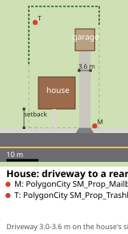 | 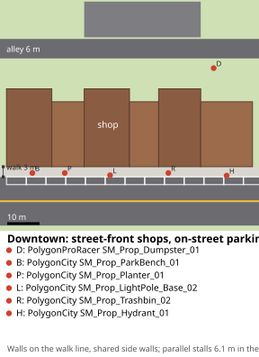 |
| 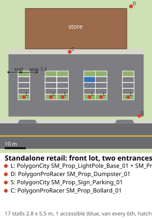 | 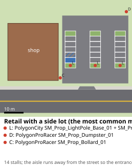 |
| 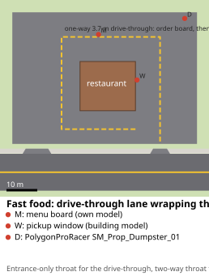 | 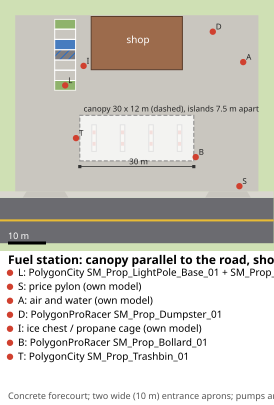 |
| 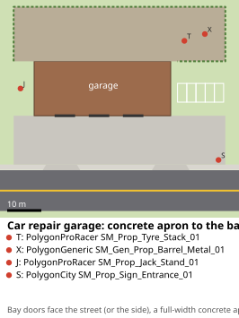 | 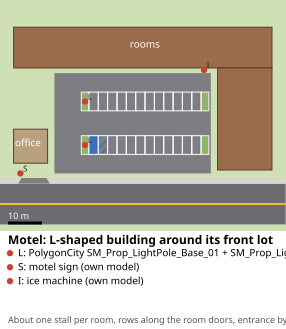 |
| 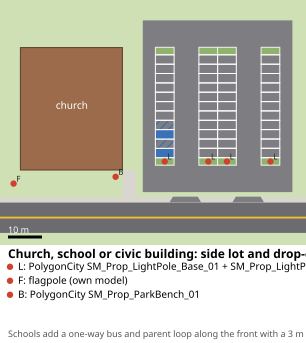 | 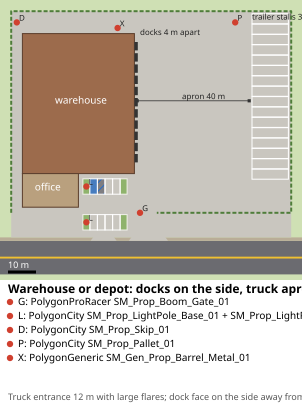 |
| 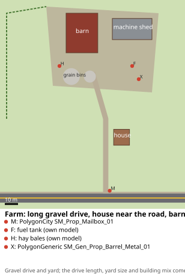 | 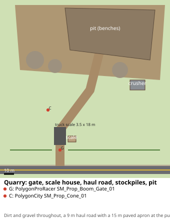 |
| 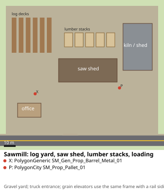 | 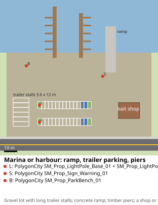 |

The real templates the generator fits are drawn in `docs/research/08-site-layouts/templates-*.svg`.

## 13. Validation (sites-S5)

`Sites.Validation` (plans complete; no overlaps with buildings, roads or other plans; every stall inside its lot and reachable from an entrance; ADA counts; entrances are baked cuts; grades; terrain under surfaces; props clear of stalls, aisles and doors), `Sites.MatchesProfile` (the generated town measured with the study's own code against the p10-p90 bands; ≥ 70 % inside), bake twice → identical hashes, `m3.shots.sites`.

## 14. Open points for the user

| # | Question | Recommendation |
|---|---|---|
| 1 | Use the chosen town's own map for lots where it has them, and fill only the gaps with templates and rules? | **Yes** (this design). It keeps the town recognisable. |
| 2 | Generate driveways for houses the map leaves without one (most: only 4 % of houses have a mapped driveway)? | **Yes**, by the measured rules (side drive, garage behind or beside). |
| 3 | Paint accessible stalls, arrows and fire lanes? | **Yes**: small cost, strong "real place" cue. |
| 4 | More OSM samples: the 15-town sample is thin for stalls (17 mapped), fuel canopies (9) and building tags (storeys on ~1 % of buildings, roof shapes on < 1 %). Allow one more Overpass batch of ~15 well-mapped towns (same query, ODbL)? | **Optional.** The chosen town's own extract will be measured anyway (sites-S0 step 5); a second batch mainly helps lane A's roof shapes and storeys. |
