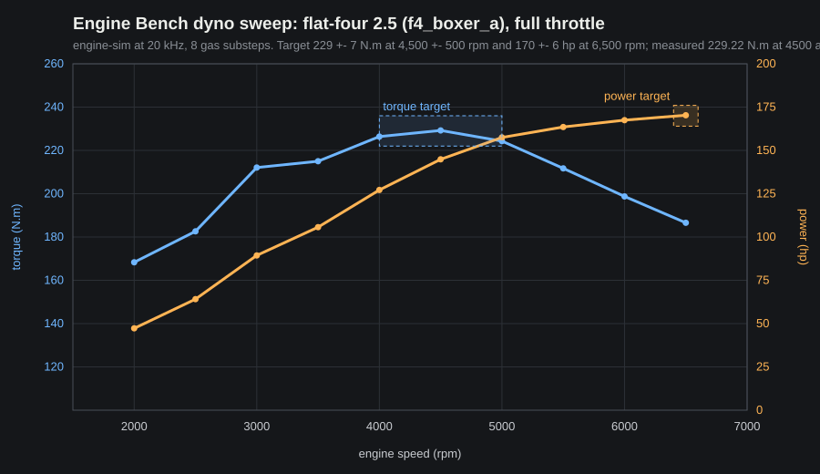

# M1 report: Millbrook in Unity + the Engine Bench

Tag `m1`, 2026-10-18. Milestone gate: **19 of 19 steps green** in 367 s (`docs\gates\M1.json`), after a green nightly (25 steps, 3,016 s).

## In plain words

- **Play it:** double-click `builds\M1\Play.bat`. Millbrook opens, built in Unity from the frozen canon. Fly with W A S D while holding the right mouse button (Q/E down and up, Shift fast, mouse wheel changes speed). Keys 1 to 0, minus and equals jump to the 12 views of the contact sheet below; P jumps between places; T switches between 10:00 and 21:00; H hides the help line.
- **The Engine Bench:** press Esc and choose Engine Bench. Tap I for ignition, hold I to crank the flat-four, rev it with W, press D for a dyno sweep. Your build lists the three built-in engines (flat-four, cross-plane V8, synthetic inline-four); the 25 upstream engine-sim scripts are in Dev builds only.
- **Credits:** Esc, then Credits: the OpenStreetMap credit and every licence.
- **F10:** four questions: same town as the browser game? which view looks most different? does the engine sound real? any crackles?

## Millbrook: the 24 canon views

Unity's shots next to the browser game's (`m1.shots.canon`, 1600x900): mean similarity (SSIM) 0.869, day views 0.91-0.96, night views 0.71-0.88 (night lighting is tuned by eye; Unity's tonemapping differs from three.js). Not in M1: grass, the two boats, parked vehicles, the blue place-marker rings.

## The engine: dyno sweep

## Gate table (milestone tier, `gate.ps1 -Tier milestone -Gate M1`)

| Step | Result | Time | Detail |
|---|---|---|---|
| nightly.green | pass | 0.1 s | nightly at ce0b806: 25 steps, 3,016 s |
| env.check | pass | 2.4 s | |
| oracle.export | pass | 46.3 s | gen-hash, verify-canon, export twice, identical |
| vendor.check | pass | 0.9 s | 584 vendored files, 5 licence files, 0 differences |
| native.ctest | pass | 1.0 s | quick tier 12/12 |
| unity.editmode | pass | 31.4 s | 91 of 91 (incl. Canon.ManifestHashes, Canon.Counts, World.HeightProbes, World.RayHits, World.PlacementsRoundTrip, Render.TerrainLod0BitExact, Render.PaneNamesResolve, Render.StaticPropsBuckets, Licence.OsmAttribution) |
| build.client | pass | 28.4 s | `builds\M1`, 158.2 MiB; Millbrook first, then Engine Bench, then the test yard |
| build.dev | pass | 27.3 s | `builds\M1-dev`, 221.1 MiB |
| build.server | pass | 28.0 s | `builds\M1-server`, 157.3 MiB, no plugin inside |
| autotest.br-smoke | pass | 14.6 s | Client build, 0 network endpoints |
| soak.server-canary | pass | 18.7 s | logs `CANON v1 OK H=a8908d7f...`, loopback only |
| lfs.budget | pass | 1.2 s | 115.1 MiB in 58 LFS objects, 1.9 % of 6 GiB |
| licence.notices | pass | 0.7 s | 10 shipped entries |
| autotest.m1.shots.canon | pass | 17.3 s | 24 shots + contact sheet |
| autotest.m1.bench.revcycle | pass | 29.3 s | 60 fps: pitch within ±3 % at idle/25/60/100 %, 0 underruns, no clipping |
| autotest.m1.bench.revcycle-fps30 | pass | 29.4 s | 30 fps: the same |
| autotest.m1.ui.credits | pass | 9.6 s | OSM credit and notices shown |
| autotest.m0.crash.recover | pass | 12.3 s | |
| autotest.m0.net.egress | pass | 67.5 s | no outbound connections |

## Headline and lane gates, expected vs measured

| Gate | Expected | Measured | |
|---|---|---|---|
| World.HeightProbes (reference path) | height within 1e-5 m | 0 m error (bit-exact) | pass |
| World.RayHits | 12 x 4,096 rays within 1 mm | 49,152 of 49,152 bit-identical | pass |
| World.PlacementsRoundTrip | 1e-4 m, 0.01 deg | max 1.5e-5 m, 4.4e-5 deg | pass |
| Render.TerrainLod0BitExact | 256 chunks bit-exact | 4,260,096 vertices, 0 differ | pass |
| Flat-four cranks and idles | 700-900 rpm within 3 s | starter off at 2.10 s, idle 731-850 rpm | pass |
| WOT dyno | 229 ± 7 N·m at 4,500 ± 500 rpm; 170 ± 6 hp at 6,500 | 229.2 N·m at 4,500; 170.3 hp | pass |
| FOLLOW_RPM ramp | < 30 rpm RMS | 0.0 (engine-sim's dyno holds speed exactly) | pass |
| Step accounting, 600 s | ±1 step at timeScale 1 and 0.5 | exact | pass |
| Rendered WAV pitch, 25/60/100 % | §1.9 rule | 9/9 windows | pass |
| ASan soak, 10 min | 0 reports, < 1 MB, 0 underruns | 0 reports, 0.047 MB, 0 underruns (nightly `native.asan` pass) | pass |
| Release soak, 10 min, full quality | 0 steady-state underruns | **1 underrun (about 30 ms, 9 stale collects)** in the nightly; lane V saw 1 in 3 runs before | **fail** (lane gate) |
| esp_cosim_matrix | report; ABI v1 freezes on it | 33/33 cases | pass |
| Real-time factor, Ultra, E-pinned | ≥ 1.5 | 2.46 (P-cores 3.07) | pass |
| Real-time factor, Low, min-spec proxy | ≥ 1.5 | 3.15 | pass |
| Main thread per FixedUpdate, p99 | ≤ 0.10 ms | 0.008 ms (60 fps), 0.007 (30), 0.009 (proxy) | pass |
| esp_all_engines | report | 25/25 upstream engines | pass |
| Flythrough, 2560x1440 High | p95 ≤ 16.6 ms | p95 7.6-7.8 ms over 3 runs (main thread 1.8 ms) | pass |
| All chunks built at load | ≤ 1.5 s | 15 ms | pass |
| Flythrough, min-spec proxy, Low | p95 ≤ 33 ms | 33.4 ms, which is the 30 fps cap itself | pass (at cap) |
| S-AUD-1 remote audio | ≥ 12 dB at 20 m, pans | 26.0 dB, full left/right pan; remote engines use `IAudioGenerator` | pass |

Lane W first measured the flythrough at 17.6 ms p95 while lane V's CPU-heavy tests ran on the same machine; the nightly on main, with nothing else running, measured 7.6-7.8 ms.

## What each lane delivered

| Lane | Cards | Merged | Handoff |
|---|---|---|---|
| W | T1.1 canon importer, T1.2 WorldGrid (float and double-precision paths), ColliderGrid, T1.3 terrain chunks, T1.4 Millbrook scene and fly camera, T1.5 shots and perf autotests; ADR-001 | 1a1d528 | `M1-handoff-W.md` |
| V | T1.6 plugin v1 (worker, step-indexed rings, coast mode, renderSync, FIR, resampler, builtins, `esp_cli`, ctest tiers), piranha + 25 engines, T1.7 C# side and Engine Bench, T1.8 spike S-AUD-1; ADR-002 | 59aab6c | `M1-handoff-V.md` |
| I | glTFast 6.20.0; lane autotest scenarios; quality presets (`-br-quality`) and the min-spec harness; Esc menu, Credits with the OSM credit; M1 checklist; STP kept for Low; gate tiers for M1 | main | this file |

## Frozen at this tag

- **CanonData v1** (ADR-001): files, hashes and the coordinate rule.
- **EngineSimPlugin ABI v1** (ADR-002), including the step-lag semantics, `esp_debug_crash_test` and `esp_set_crash_dir`.
- The plugin DLL in this commit is the one `builds\M1` ships: abi 1, piranha on, sourceHash `6177805...bf17`.

## Decisions due next (approvals queue)

- **U4a, Unity update (you, in Unity Hub):** install the newest 6.3 patch (6000.3.26f1 or later) before the M2 lanes start; the agents then apply the U3a package bumps once, so every `Library` re-imports once. Default: stay on 6000.3.20f1.
- **U6, the truck's engine voice:** an authentic big-block gas V8 (recommended), or a diesel-character inline-six stand-in.
- **U9, names:** fictional names for the "Ranger 4x4" and the "Muncher D3". Agents propose, you pick; default placeholders "Pickup A" and "Dozer A".
- **U15, canon v1.1:** road plates may change the ground only inside road footprints + 15 m, everything else bit-identical; play-time ruts are identical across players but only statistically equal to the browser game's. Recommended: accept.
- **U5a** (end of M2): does M2 drive like the browser game? Play and tell us with F10.

## Carried to M2

- **Release soak underrun (lane V):** one roughly 30 ms underrun in some 10-minute release soaks (1 in about 3). Likely an OS scheduling stall of the worker; candidates: register the worker with MMCSS ("Pro Audio"), a slightly larger fill target, and logging which step stalled. It must reach 0 before the engine drives a vehicle.
- `-br-silent` mutes the master volume, so it also silences `AudioTap`: audio autotests must not use it, or it should mute differently.
- `build-native.ps1 -Heavy` re-installs the plugin DLL even when the sources are unchanged, which dirties the committed DLL; it should leave an identical build alone.
- The server build uses the client scene list (8 harmless "missing script" warnings).
- `build.json` has no plugin stamp yet (`esp: -`).
- Not yet in Millbrook: grass, boats, parked vehicles, place-marker rings.
- Still open from M0: official licence texts before any public build; fonts not yet added.
